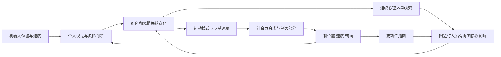
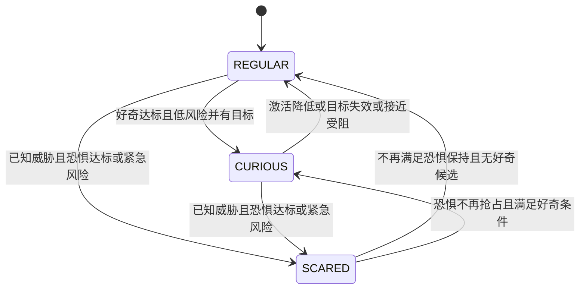

# 当前动态心理与行人人群模型详细说明

整理日期：2026-10-21；2026-10-22更新八人路线与演示说明。说明对象为 `/home/lpc/workspace/arena5_multi_ws`，
核对源码版本 `3f20542`，分支 `feature/dynamic-psychology-v1`。
默认心理配置为 `sis_cf_v1`，模型版本 `1.0`。
本次八人配置更新未修改上述心理和运动源码。
本文说明当前已实现的机制、运动切换和演示，不将后续设想当作现有功能。

## 1. 当前人群模型是什么

当前采用的是**微观多智能体人群模型：多机器人社会力运动后端 + 每人双通道 SIS 型心理动力学 + 有向局部心理传播 + 行为状态选择**。

每个行人都是独立计算的个体，保存自己的位置、速度、朝向、任务目标、好奇量、恐惧量、
行为模式和有限观察记忆。人群整体变化由这些个体之间的运动作用和心理传播共同产生。
系统没有用一组总人口数量方程代替每个行人，也没有将整个人群统一设为某种心理状态。

| 层次 | 当前实现 | 负责的问题 |
|---|---|---|
| 机器人运动 | 独立命名空间下的 Nav2 导航 | 机器人如何到达任务目标 |
| 行人原始任务 | 多目标队列，支持 `loop` / `ping_pong` | 没有心理干预时，行人去哪里 |
| 个体心理 | `sis_cf_v1`，连续好奇量 `c` 和恐惧量 `f` | 心理如何受刺激、传播、恢复 |
| 心理传播 | 随位置和朝向变化的有向邻接图 | 哪个行人影响哪个行人、影响多大 |
| 行为选择 | `REGULAR` / `CURIOUS` / `SCARED` 及附加标记 | 心理如何转为任务行走、接近、远离等意图 |
| 实际行人运动 | `multi_sfm`，固定版 LightSFM 内核及项目扩展 | 意图、人际作用、人机作用和墙体作用如何合成实际运动 |
| Isaac 显示 | 适配器将已计算运动写入 Character Graph | 将运动结果显示出来并独立核对实际角色位置 |

可以将当前闭环理解为：



因此，“机器人影响心理 → 心理传播 → 行为变化 → 运动改变后续感知与传播”已经在代码中连接起来。
当前默认配置侧重局部影响和可恢复性；强传播作为单独实验配置提供。

## 2. 三类状态需要分别理解

### 2.1 连续心理状态

每人保存两个连续量：

| 变量 | 范围 | 含义 |
|---|---|---|
| `c = curiosity` | `[0,1]` | 对机器人产生的好奇激活程度 |
| `f = fear` | `[0,1]` | 恐惧或威胁相关激活程度 |

初始值均为零。二者可以同时大于零，不要求 `c + f = 1`。
例如 `c=0.7, f=0.2` 表示仍然好奇但已有一定顾虑；行为还要结合风险、目标知识和之前的模式决定。

这里的数值是工程化心理激活量，并非通过摄像头识别得到的真实情绪概率。

### 2.2 三个离散运动模式

| 模式 | 数值 | 主体运动意图 |
|---|---|---|
| `REGULAR` | `0` | 继续原任务，可能叠加警戒、等待或回归过程 |
| `CURIOUS` | `1` | 对选定机器人进行有界接近、观察或小幅后退 |
| `SCARED` | `2` | 根据个人已知威胁生成远离意图 |

模式由 `BehaviorIntent.mode` 和心理诊断中的 `behavior.mode` 表达。
为兼容普通行人消息，`Agent.behavior.type` 始终保持 `1`，不能用这个旧字段区分上述模式。

### 2.3 附加状态与实际运动

以下信息可以与三个模式组合：

| 标记或原因 | 含义 |
|---|---|
| `vigilant` | 警戒开关；在 `REGULAR` 下用于降低朝原目标的期望速度 |
| `approach_blocked` / `approach_wait` | 接近预计与邻人冲突，进入重试等待 |
| `returning_to_task` | 特殊行为曾中断任务，正在完成原路线的衔接 |
| `return_goal` | 中断任务时需要返回的原目标位置 |
| `paused` | 系统因一致的仿真时钟停顿暂停推进，属于运行保护 |

“站着不动”不是第四个心理模式。它可能来自好奇观察时接近期望净距、等待重试、
已经足够远离威胁、到达任务目标，或者运行保护。判断原因要同时看模式、原因、意图和实际速度。

## 3. SIS 型心理动力学如何工作

### 3.1 方程

对行人 `i`，定义心理激活输入：

```text
lambda_Ci = alpha_C * direct_Ci + beta_C * social_Ci
lambda_Fi = alpha_F * direct_Fi + beta_F * social_Fi

dc_i/dt = (1-c_i) * lambda_Ci - mu_C*c_i - kappa*f_i*c_i
df_i/dt = (1-f_i) * lambda_Fi - mu_F*f_i
```

`(1-c)`、`(1-f)`表示激活接近上限后，继续增长的空间减小。
`mu*c`、`mu*f`表示恢复或衰减。`kappa*f*c`表示恐惧对好奇的额外抑制。

“SIS 型”的含义是借用“受影响后激活、随后恢复、恢复后仍可再受影响”的结构。
当前实现是两个可共存的连续激活通道，并未把人划成互斥的感染舱室；也没有实现 SEIR 的潜伏舱室。
`REGULAR/CURIOUS/SCARED` 是由心理与认知条件选出的行为，不能直接等同于传染病模型的舱室。

### 3.2 默认参数

| 参数 | 好奇通道 | 恐惧通道 | 作用 |
|---|---|---|---|
| 直接刺激系数 `alpha` | `alpha_C=0.60` | `alpha_F=1.00` | 机器人直接刺激的作用强度 |
| 人际传播系数 `beta` | `beta_C=0.06` | `beta_F=0.12` | 其他行人心理线索的作用强度 |
| 恢复系数 `mu` | `mu_C=0.12` | `mu_F=0.25` | 心理激活的衰减速度 |
| 外显系数 | `expressivity_C=0.8` | `expressivity_F=0.8` | 内在激活转为可传播线索的比例 |

以上速率以仿真秒为时间基础；`kappa=0`。
默认没有额外的 `kappa*f*c` 抑制，但直接好奇刺激仍被直接恐惧输入削弱，
行为层也限制了高恐惧时的好奇接近。

如果直接输入和人际输入都为零，默认心理量按指数恢复：

```text
c(t) = c(0) * exp(-0.12*t)
f(t) = f(0) * exp(-0.25*t)
```

对应半衰期约为好奇 `5.78` 秒、恐惧 `2.77` 秒，均为仿真时间。
这是无输入时的结果；仍能观察到刺激或接收到传播时，恢复不会简单遵循上述单一指数。

默认行权重和不超过1，外显系数不超过1，且 `beta < mu`，为无直接外源时的整体衰减提供保守条件。
这也意味着默认配置通常展示局部警戒和恢复，不能预设一定产生持续的大范围恐慌。

### 3.3 数值更新

心理与行人核心以 `dt=0.025` 秒仿真时间推进。每步先冻结旧状态计算所有人的输入，
再同步生成下一步候选，避免先更新的人在同一步内连续影响后更新的人。

对单通道 `z`，冻结输入 `lambda` 和恢复系数 `d`，使用：

```text
z_next = z + (lambda/(lambda+d) - z) * (1-exp(-(lambda+d)*dt))
```

好奇取 `d=mu_C+kappa*f_old`，恐惧取 `d=mu_F`；总速率为零时保持原值。
实现使用 `expm1` 提高小步长计算精度，显著越界直接报错。
该式是冻结系数子问题的精确解，整个人际耦合系统的时间离散仍为一阶近似。

## 4. 机器人如何产生直接刺激

### 4.1 看见机器人的条件

默认机器人心理视觉范围为 `8` 米，视野总角为 `200°`。
正前方左右各 `90°` 内为完整可见权重，`90°～100°` 为每侧 `10°` 线性过渡，
超出视野或距离达到8米时权重为零。范围内没有额外的视觉距离衰减项。

朝向来自行人运动状态，严格零速时保留前次朝向。当前没有独立头部转动、听觉或遮挡判断，
配置为 `occlusion_model: none_open_space`。

### 4.2 风险计算

风险使用人机当前净距、相对接近速度和未来2秒内最近接近预测。
净距定义为：

```text
gap = 两者中心距离 - 行人半径 - 机器人半径
```

当前八人场景行人半径为 `0.4` 米，适配器中的机器人等效半径为 `0.35` 米。
例如中心距离1米时，人机净距为0.25米。

令 `clip(x)` 将数值限制到 `[0,1]`。当前距离风险为：

```text
r_current = clip((0.8-gap)/(0.8-0.15))
```

若相对运动仍在接近，计算最近接近时刻 `t*`。当 `0<t*<=2` 秒时：

```text
r_prediction = clip((0.8-predicted_gap)/(0.8-0.15)) * (1-t*/2)
r = clip(r_current + (1-r_current)*r_prediction*clip(closing_speed/0.5))
```

因此，机器人低速运动也可能因为距离近、行人主动迎向机器人或路线相交而形成较高风险。
已经很近的静止机器人也可能产生当前距离风险；不能仅凭机器人速度判断恐惧输入。

### 4.3 新颖性与直接输入

对每个行人、每台机器人分别保存新颖性 `n`，首次看到时为1。
仅在看见时衰减：

```text
n_next = n_old * exp(-0.05*visibility*dt)
```

设 `V_ik` 为可见权重、`r_ik` 为风险，多台机器人的直接输入组合为：

```text
direct_Fi = 1 - product_k(1-V_ik*r_ik)
direct_Ci = (1-direct_Fi) * [1-product_k(1-V_ik*n_ik)]
```

组合结果有上限，多台机器人不会简单相加到1以上。
恐惧相关直接输入越强，直接好奇输入受到的抑制越强。
新颖性降低可以解释持续观察后的兴趣回落；同一机器人短暂消失不会重置为全新对象。

## 5. 心理在人群中如何传播

行人 `j` 的心理外显线索为：

```text
cue_Cj = 0.8*c_j
cue_Fj = 0.8*f_j
```

线索连续产生，不以是否进入 `CURIOUS` 或 `SCARED` 为开关。
一个仍在正常走路、恐惧尚未达到行为阈值的人，也可以向邻人传播较弱的恐惧线索。
这些线索是模型假设，没有接入表情、姿态或声音识别。

传播边 `j → i` 表示“行人i看见行人j并受到影响”，不要求反方向也存在。
当前传播范围为3米，使用接收者i的视野判断：

```text
raw_ij = max(0,1-distance_ij/3)^2 * visibility(i,j)
w_ij = raw_ij / max(1,sum_j raw_ij)

social_Ci = sum_j(w_ij*cue_Cj)
social_Fi = sum_j(w_ij*cue_Fj)
```

距离越远，传播越弱；同一接收者的总权重不超过1。
位置变化、转身和临时接近会让边出现、消失或改变权重，从而改变下一步心理输入。
这里描述的是局部传播，初始相距较远的行人未必直接连接。

传播只传递心理线索，不携带“威胁是哪台机器人、机器人在哪里”的信息。
因此，有人可以因邻人的恐惧而警戒，但在自己没有观察过威胁时不能获得定向逃离知识。

## 6. 个人记忆与目标选择

个人机器人记忆记录最后观察的位置、速度、半径、时间以及新颖性历史。
失去视野后，只能根据最后观察做有限预测，不能读取隐藏机器人的实时位置：

| 参数 | 默认值 | 含义 |
|---|---|---|
| `memory_ttl` | `2` 秒 | 几何记忆允许使用的最长时间 |
| `memory_tau` | `0.8` 秒 | 置信度按 `exp(-age/0.8)` 衰减 |
| `memory_prediction_horizon` | `0.75` 秒 | 最多外推0.75秒运动 |
| `minimum_memory_confidence` | `0.2` | 低于该置信度时不能作为已知目标 |

两个有效性条件必须同时满足。按当前参数，置信度条件约在 `1.29` 秒失效，
因此实际几何知识通常早于2秒TTL上限失效。超过0.75秒后不继续无限外推。
几何知识失效不等于删除历史新颖性；再次看见同一机器人时延续上次新颖性。
记忆可用于延续已有目标和判断方向，但不会额外生成直接刺激或心理传播边。

多机器人目标选择规则如下：

- 恐惧选择个人已知的“风险×置信度”最高者；紧急判断也使用最大单个已知威胁评分。
- 好奇对可见机器人使用“可见度×新颖性×(1-风险)”评分。
- 已处于好奇模式时，原目标在有效记忆内且风险允许，可以继续保持。
- 默认目标最短保持1秒；之后新目标评分需超过旧目标0.15才切换。
- 原目标知识失效时可以立即放弃；紧急风险允许越过目标保持限制。
- 同分时依照稳定ID顺序选择，避免不确定抖动。

人际运动避让还有独立邻人记忆：观察范围为5米，采用同样的时间、置信度和预测上限。
**5米邻人运动观察范围与3米心理传播范围是两个不同用途的参数。**

## 7. 行人运动模式如何切换

### 7.1 决策顺序

每次心理更新后按以下优先级选择：

```text
紧急风险 → 有来源的恐惧远离 → 低风险好奇接近 → 原任务运动
```

随后检查好奇接近是否与邻人冲突，再按需要筛选局部期望速度。
最终状态不只取决于某一个心理阈值，还取决于个人是否知道目标、风险是否允许、
之前处于什么模式以及是否处于接近等待期。

### 7.2 切换条件表

以下数值来自默认配置；阈值判断使用本次更新后的心理量。

| 状态或转换 | 进入、保持条件 | 退出或转向条件 |
|---|---|---|
| 任意模式 → `SCARED`：紧急 | 最大单个已知威胁评分 `>=0.85`，可在恐惧量很低时触发 | 后续按威胁是否仍存在、恐惧保持条件和优先级重新判断 |
| `REGULAR/CURIOUS` → `SCARED`：常规 | 至少有一个正风险的已知威胁，且 `f>=0.65` | 进入后适用下面的恐惧保持规则 |
| 保持 `SCARED` | 仍有已知正风险威胁，且 `f>0.35` 或本模式尚未保持0.5秒；紧急风险也可保持 | 无已知威胁时立即失去定向远离依据；否则在 `f<=0.35` 且保持满0.5秒后结束，前提是无紧急风险 |
| `REGULAR/SCARED` → `CURIOUS` | `c>=0.60`，`f<=0.25`，直接恐惧输入 `<=0.25`，有兴趣目标，等待期结束，且没有更高优先级恐惧行为 | 接近可行性检查还可能将结果改为等待 |
| 保持 `CURIOUS` | 风险条件仍满足、目标有效，且 `c>0.35` 或本模式尚未保持0.5秒 | `c<=0.35` 且保持满0.5秒；或目标知识失效、风险条件失效、恐惧抢占、接近冲突 |
| 进入警戒 | 原先未警戒且 `f>=0.08` | 已警戒时仅在 `f<=0.04` 后清除 |
| 进入接近等待 | 好奇候选运动在未来2秒内与已知邻人的预测净距 `<0.35` 米 | 2秒等待结束后重新判断是否允许好奇；紧急或有来源恐惧可先抢占 |
| 恢复原任务 | 没有满足更高优先级的特殊模式条件 | 新刺激仍可再次触发好奇或恐惧 |

好奇/恐惧进入阈值比退出阈值高，称为滞回，目的是减少阈值附近的反复切换。
0.5秒最短保持只延续仍有依据的特殊模式，不允许借此继续追踪已经失效的目标。
风险变高也可以立即中断好奇，不能理解为每个行为必须强制完成固定时长。

特别注意：

- `f>=0.65` 但没有正风险的个人已知威胁时，保持 `REGULAR+vigilant`，原因可记为 `unknown_threat`。
- 恐惧可在机器人仍存在时恢复，也可因来源知识失效而停止定向远离；心理量本身不会因此被清零。
- `SCARED` 退出后可能回原任务，也可能在之后满足条件时转为好奇；没有固定三阶段顺序。
- `vigilant` 可与特殊模式同时被记录，但对应减速公式只在普通任务分支使用。



图中三个节点表示主模式；警戒、等待、返回路线和系统暂停应结合附加字段判断。

## 8. 各模式怎样生成运动

### 8.1 普通行走与警戒

普通中性行人朝原任务队首目标运动。当前八人配置的基础期望速度来自 `max_vel=1.0 m/s`。
警戒时朝同一任务目标的期望速度为：

```text
v_task_desired = min(1,base_desired_velocity) * (1-0.4*f)
```

例如 `f=0.2` 时速度系数为0.92；`f=0.8` 时为0.68。
这是目标期望速度，实际速度还受后述力项和限幅影响。

### 8.2 好奇：接近、观察与小幅后退

设 `e_to_robot` 为指向目标机器人的单位向量，`g` 为当前人机净距：

```text
s_C = clip_to_interval(0.7*(g-0.9), -0.2, 0.35)
v_desired = s_C * e_to_robot
```

| 人机净距 | 好奇原始期望 |
|---|---|
| 大于0.9米 | 接近机器人，接近速度最多0.35米/秒 |
| 等于0.9米 | 该目标的期望速度为零，呈观察停留意图 |
| 小于0.9米 | 小幅后退，后退速度最多0.2米/秒 |

0.9米是身体边界之间的净距。按当前半径，相应中心距离约为1.65米。
机器人仍在运动时，观察点也随目标位置变化，不能保证行人绝对静止。
配置中的 `curiosity_stop_band=0.15` 供验证工具定义观察带；行为函数没有在整条带内强制速度为零。

### 8.3 恐惧：综合已知威胁远离

所有已知正风险机器人的“背离方向”按风险和置信度加权合成。
方向抵消时使用选定主要威胁的背离方向。
运动强度根据这些威胁的净距取最大需求：

```text
s_F = max_over_positive_risk_threats(min(0.8,max(0,0.8*(1.5-gap_to_threat))))
v_desired = s_F * normalized(combined_away_direction)
```

远离期望速度最多0.8米/秒，目标净距为1.5米。
已足够远时远离期望速度可以降为零，即使模式或心理量尚未立即退出。
这是一种局部远离意图，当前没有全局逃生出口选择或避难点规划。

### 8.4 接近受阻与等待

好奇原始期望速度会先与可见或有效记忆中的邻人运动作2秒预测。
若预测净距小于0.35米：

1. 保留连续心理量，不删除已经产生的好奇。
2. 将主模式改为 `REGULAR`，记录 `approach_blocked`，取消本次定向接近目标。
3. 设置2秒后重试；等待中记录 `approach_wait` 并先提出零期望速度。
4. 允许恐惧优先级抢占，也允许局部避让调整等待时的速度。

所以“停止接近”并不等于“不再好奇”，也不等于实际速度会立刻归零。

### 8.5 返回原路线与局部避让

特殊行为会记录原任务的回归目标。
返回目标尚未到达、原队列也未正常推进时，`returning_to_task=true`。
进入新的特殊行为还会继续更新与保存正确的任务衔接目标。

对特殊行为、等待、警戒和返回原任务期间，系统可对期望速度施加局部邻人约束。
令 `n` 为邻人指向自己的单位向量，`g_h` 为人际净距：

```text
n · v_desired >= n · v_neighbor - (g_h-0.35)/2
|v_desired| <= 1
```

在多个人际半平面和速度圆的交集中，选择最接近原始期望的可行速度。
不可行时选择有限候选中违反量较小的有界结果，并记录 `avoidance_feasible=false`。
这是一种局部行为预判，不是独立的硬接触碰撞求解器，也没有实现完整 ORCA 系统。
中性、未处于回归期且不警戒的普通分支继续使用原有运动路径。

以上0.35、0.8等行为速度是局部筛选之前的上限；避让筛选可以改变其大小和方向，
最终候选仍受1米/秒速度圆限制。因此不能据实际速度超过0.35米/秒就断言好奇模式没有生效。

## 9. 社会力如何决定最终位置与速度

### 9.1 力项组成

行人动力学以固定版 LightSFM 的单个行人与逐对作用核为基础。
当前社会力核包含相对速度、相对位置和交互角度的影响，兼有减速与侧向避让分量。
本项目在同一时间快照内，对所有其他行人及所有机器人分别计算并合成作用。

```text
a_raw = F_desired + F_wall
        + sum(other_people_social_force)
        + sum(robot_social_force)
        + sum(robot_physical_near_force)
```

这些“力”在实现中直接形成等效加速度，没有为每个人另设质量参数。
心理意图覆盖生效时，目标驱动力为：

```text
F_desired = goal_force_factor * (v_desired-v_actual) / relaxationTime
```

当前 `goal_force_factor=2`，LightSFM 默认 `relaxationTime=0.5` 秒。
因此特殊行为通过替换目标驱动力影响运动；墙体、人际、人机社会项和物理近距离项继续存在。
心理模型本身返回的四个兼容倍率 `speed_scale/social_scale/robot_scale/space_scale` 当前均为1。
`space_scale` 是保留字段，当前核心不据此扩大身体或近距离项。

### 9.2 社会作用、心理感知与物理近距离项

| 机制 | 当前作用方式 | 是否受心理行为关闭 |
|---|---|---|
| 人际社会力 | 对所有其他行人计算逐对核；没有额外套用心理传播的3米/FOV截断 | 否 |
| 人机社会力 | 对全部机器人逐对计算，受C++核心自己的200°人机社会FOV加权 | 否；当前模型倍率为1 |
| 人机物理近距离项 | 所有方位存在，越近越强 | 否 |
| 心理直接刺激 | 8米心理视觉范围及心理FOV | 只在心理层计算 |
| 心理传播 | 3米有向距离/FOV图 | 只在心理层计算 |

C++核心的人机社会FOV与心理配置中的机器人FOV属于两套配置，当前默认数值相同；
修改心理YAML并不会自动修改C++服务的FOV参数。

人机物理近距离项近似写为：

```text
F_near = away_unit * 10 * exp(clamp((0.1-gap)/0.2,-50,10))
```

它不因机器人位于背后、行人处于好奇模式或心理激活降低而关闭。
0.1米是该指数项的参考净距参数，不能直接解释成强制保持的硬几何边界。

### 9.3 限幅、积分与显示

合成等效加速度上限为 `3 m/s²`。有意图覆盖时，更新形式为半隐式Euler：

```text
a = limit_norm(a_raw,3)
v_next = limit_norm(v+a*0.025,1)
x_next = x+v_next*0.025
```

无意图覆盖的普通分支使用原 LightSFM 更新，速度按基础期望速度限幅；当前八人基础值为1米/秒。
在原目标已到达或没有目标时，普通分支使用原有减速逻辑。
两条路径每步都只积分一次；外部机器人状态作为输入，不由行人核心积分。

运动结果通过适配器写入Isaac。实际角色显示位置与核心提交位置由运行验收单独比较。
因此，期望速度为零仍可能存在减速过程、残余速度或排斥引起的运动；
实际轨迹也不会因为模式切换而瞬移到新的目标或停留距离。

当前核心对四周矩形边界计算墙体作用并校验身体包络。
内部复杂障碍、墙体遮挡和出口路径推理不属于当前心理模型已覆盖的能力。

## 10. 原多目标任务如何暂停和恢复

当前默认行人路线有四个命名目标点，目标到达半径为0.3米。

| 主模式或过程 | `allow_task_progress` | 原任务队列 |
|---|---|---|
| `REGULAR` 普通任务 | `true` | 实际到达队首目标后推进 |
| `REGULAR+vigilant` | `true` | 保持原任务，可减速推进 |
| `CURIOUS` | `false` | 完整保留，不消费目标 |
| `SCARED` | `false` | 完整保留，不消费目标 |
| `REGULAR` 接近等待 | `true` | 通常因零期望不推进；如果实际到达原目标，仍允许推进 |
| `REGULAR` 返回路线 | `true` | 朝原目标返回，到达或正常轮换后清理回归标记 |

特殊行为结束时，从当前真实运动位置、速度继续原任务，而不是恢复中断前的位置。
每步最多推进一个原目标。

路线编译例子：

```text
loop:      g0 → g1 → g2 → g3 → g0 → ...
ping_pong: g0 → g1 → g2 → g3 → g2 → g1 → g0 → ...
```

折返路线通过扩展现有循环队列实现，不在模式切换时另建一套任务系统。

## 11. 当前演示具体安排

默认场景为 `two_robots_multi_sfm_8_multigoal_psychology_nav2.yaml`：

- 开放矩形场地30×23米，共用 `map` 和 `/clock`。
- 两台机器人从 `(3,3)`、`(3,7)` 出发，Nav2使用Dijkstra，线速度上限0.26米/秒、角速度上限1弧度/秒。
- 八人使用独立场景文件，原六人场景保持原样；前六人起点仍为 `(8,3)`、`(8,6)`、`(8,9)`、`(8,12)`、`(8,15)`、`(8,18)`，新增两人为 `(15,3.5)`、`(15,11)`，初始朝向向上。
- 每人四个不同目标点，横向跨度4.5米；1/2/3/7号四点循环，4/5/6/8号沿四点折线路线正反往返，布局见[场景更新记录](PSYCHOLOGY_MULTIGOAL_20261022.md)。
- 每人半径0.4米，基础期望速度1米/秒；均为无群组个体 `group_id=-1`。
- 使用默认弱传播、可恢复配置；每人共享同一组心理参数，因位置、观察历史及邻接关系不同而产生差异。

开启自动任务后的安排如下。表中是导航目标，实际路径由Nav2产生：

| 轮次 | robot_1目标 | robot_2目标 | 额外设置 |
|---|---|---|---|
| 1：靠近 | `(7,3,0)` | `(7,11.5,0)` | 两机同时发送 |
| 2：穿行 | `(11.5,6,0)` | `(16,8,0)` | robot_2延迟10秒仿真时间发送 |
| 3：返回 | `(3,3,π)` | `(3,7,π)` | 两机同时发送 |

每轮两机均完成后停留15秒仿真时间，包括最后一轮。
自动任务等待行人健康、至少十次显示更新及Nav2 action就绪；只发送机器人目标。
任务结束后场景继续运行，便于观察心理恢复和路线继续。
机器人顺序并不规定行人的心理阶段，不能保证每次每个人都经历所有模式。

## 12. 系统暂停、故障与心理恢复的区别

心理恢复是上述微分方程随仿真时间的连续变化。
运行保护是另一套机制，当前版本还包含2026-10-20完成的同步时钟停顿恢复：

| 情况 | 系统处理 | 心理与行人积分 |
|---|---|---|
| 正常仿真推进 | 用同一时间快照计算候选，校验响应后提交 | 每步0.025秒 |
| `/clock`与全部机器人观察一致停顿 | 标记 `paused`、健康为False，速度守护输出零速 | 停顿期间不提交候选、不发新积分或显示写入 |
| 合法同步停顿结束 | 收到新时钟与全部机器人的新鲜非重复观测，时间跨度符合约束后恢复 | 从原事务与状态继续，停顿墙钟时间不伪装成心理经历 |
| 单机器人断流、时钟仍推进、重复旧里程计、计算/显示错误等 | 锁存故障并停车 | 不继续推进候选 |
| 时钟回退或同步停顿超限 | 锁存故障，需重新启动处理 | 不跨越错误时间积分 |

默认观测门槛仍为0.6秒；一致停顿最多等待30秒墙钟，恢复时的仿真时间跨度最多0.100001秒。
恢复后速度守护要求新命令，不复用停顿前的旧速度。
详见 [运行恢复记录](RUNTIME_RECOVERY_20261020.md)。

心理、邻人记忆、行为标记、任务和运动候选经过响应校验才共同提交。
显示写入是后续独立串行请求；显示故障会触发保护，不应理解为核心提交与Isaac写入是同一个原子事务。

## 13. 五种心理配置的实际区别

| 文件 | 与默认配置的区别 | 适合说明的问题 |
|---|---|---|
| `sis_cf_v1.yaml` | 默认参数 | 局部影响、行为转换及恢复 |
| `sis_cf_direct_only.yaml` | `beta_C=0, beta_F=0` | 去除心理传播，只保留机器人直接输入 |
| `sis_cf_enhanced.yaml` | `beta_C=1.2, beta_F=2.4` | 增强人际接力传播；含环网络可能持续激活 |
| `sis_cf_fear_only.yaml` | `beta_C=0`，恐惧传播保持默认 | 只保留恐惧的人际传播；`alpha_C=0.6`仍保留直接好奇，并非完全禁用好奇 |
| `sis_cf_inhibition.yaml` | `kappa=1` | 增加恐惧对好奇的额外抑制 |

仅创建配置文件不会自动启用它。实际运行由场景中的 `psychology_model` 和 `psychology_config` 选择。
增强场景另有独立YAML；默认场景的几何与耐久验收不能直接覆盖增强参数。

行人配置中部分兼容字段容易引起误读：

| 字段 | 当前 `multi_sfm + sis_cf_v1` 中的含义 |
|---|---|
| `max_vel: 1.0` | 读入基础期望速度；当前八人是1米/秒 |
| `behavior.type: 1` | 普通行人兼容值，实际心理模式见新意图 |
| `behavior.duration: 40`、`once: true` | 当前加载与行为决策未使用，不决定心理模式持续40秒或只发生一次 |
| `behavior.vel: 0.6`、`dist: 0.0` | 当前适配器未用于生成心理速度或观察距离 |
| `goal_force_factor: 2`、`obstacle_force_factor: 10`、`social_force_factor: 5` | 当前加载并用于对应力项 |
| `other_force_factor: 20` | 当前适配器未读取；物理near参数来自C++核心配置 |

## 14. 如何从日志判断行人为何切换

运行时心理诊断位于 `/multirobot/hunav/psychology`，提交后以schema版本2发布。
运行目录中的 `psychology_<epoch>.jsonl` 保存同类逐步记录。

| 观察内容 | 关键字段 |
|---|---|
| 心理量与变化前后 | `agents[id].old/new.curiosity/fear`；`states[id].variables` |
| 直接刺激还是邻人传播 | `direct_C/direct_F`、`social_C/social_F`、`lambda_C/lambda_F` |
| 主模式、警戒和切换原因 | `behavior.mode`、`behavior.vigilant`、`behavior.reason` |
| 目标来自当前观察还是记忆 | `visible_robots`、`target_knowledge`、`target_age_s`、`target_confidence` |
| 是否等待或返回路线 | `approach_blocked_until_ns`、`returning_to_task`、`return_goal`，均在行为对象内 |
| 原目标能否推进 | `intent.allow_task_progress`、`task_goals` |
| 邻人约束是否生效 | `approach_conflicts`、`avoidance_conflicts`、`avoidance_feasible` |
| 谁在传播给谁 | 顶层 `edges` 的 `source_id/target_id/weight/cue_C/cue_F` |
| 实际运动为什么偏离意图 | `intent.desired_velocity_x/y`、`people`位置/速度、`motion`力分项和限幅 |
| 是否系统暂停或锁存 | `/multirobot/hunav/status` 的 `healthy/paused/fault/clock_stall_recoveries` |

典型原因包括 `task`、`curiosity`、`fear`、`emergency_override`、`unknown_threat`、
`approach_interrupted`、`target_or_activation_expired`、`approach_blocked` 和 `approach_wait`。
局部避让会改变期望速度，但不一定改变已选的主模式。
导数分项日志采用步前瞬时语义；直接将其乘以dt，不必与指数更新增量完全相等。

## 15. 已有证据与适用范围

| 证据 | 已验证的内容 | 对应范围 |
|---|---|---|
| [八人多目标场景验证](../evidence/psychology_multigoal_20261022/README.md) | 原六人起点和模型保持不变；八人多点路线、实际心理变化、任务恢复及六个Nav2目标；600.055秒墙钟零失败 | 2026-10-22八人配置、GPU1及报告运行条件；不等同于三十分钟耐久 |
| [心理开发验收](../evidence/dynamic_psychology_20261012/README.md) | 原核心24,000步精确回归；固定链传播、默认恢复、增强第二跳；实际双机六人30分钟墙钟与六个Nav2目标 | 2026-10-13冻结源码及所记录配置/资源条件；不自动覆盖后续修改 |
| [同步停顿恢复结果](../evidence/runtime_recovery_20261020/final_clock_recovery/summary.json) | 600.387秒墙钟通过；主动暂停与自然停顿共两次恢复；三轮导航完成 | 源码`f0184c6`及该轮实际运行条件 |
| [当前模式与传播测试](../src/arena_multi_hunav/test/test_dual_sis.py) | 滞回、未知威胁、方向传播、记忆隔离、接近等待、回归、局部约束等 | 对应具体测试输入，不能替代任意场景安全结论 |

当前模型适合研究机器人作为刺激源时的局部心理变化及运动反馈。
个体心理参数尚未经过真人数据标定；八人默认使用同一套系数，没有显式人格或情绪识别模块。
当前没有群组关系、信任/愤怒等额外通道、密度应激方程、全局逃生规划、遮挡传播或学习策略。
社会力和局部速度约束都不能提供任意布局下的硬无碰撞保证，修改路线或参数后需要重新做场景验证。

## 16. 阅读源码与启动入口

| 内容 | 位置 |
|---|---|
| 默认参数及严格校验 | [psychology_config.py](../src/arena_multi_hunav/arena_multi_hunav/psychology_config.py)、[默认YAML](../config/psychology/sis_cf_v1.yaml) |
| 机器人视觉、风险、传播图、接近预测 | [perception.py](../src/arena_multi_hunav/arena_multi_hunav/perception.py) |
| 心理积分、个人记忆、回归状态、邻人观测 | [psychology_sis.py](../src/arena_multi_hunav/arena_multi_hunav/psychology_sis.py) |
| 模式切换、目标选择、期望速度及局部约束 | [behavior.py](../src/arena_multi_hunav/arena_multi_hunav/behavior.py) |
| 原任务路线编译 | [routes.py](../src/arena_multi_hunav/arena_multi_hunav/routes.py) |
| 加载、时间快照、事务提交、日志和Isaac写入 | [multi_adapter.py](../src/arena_multi_hunav/arena_multi_hunav/multi_adapter.py) |
| 力项合成、速度限幅及积分 | [core.cpp](../src/arena_multi_hunav_core/src/core.cpp)、[固定LightSFM](../src/arena_multi_hunav_core/vendor/lightsfm/include/sfm.hpp) |
| 场景、行人路线、机器人自动任务 | [场景](../config/scenarios/two_robots_multi_sfm_8_multigoal_psychology_nav2.yaml)、[八人配置](../config/hunav/multi_regular_8_psychology_multigoal.yaml)、[自动任务](../config/tasks/psychology_crossings.yaml) |
| 同步停顿判断 | [clock_gate.py](../src/arena_multi_hunav/arena_multi_hunav/clock_gate.py) |

已完成构建的当前工作区中，人工启动使用：

```bash
cd /home/lpc/workspace/arena5_multi_ws
./scripts/run_multirobot.sh config/scenarios/two_robots_multi_sfm_8_multigoal_psychology_nav2.yaml
```

自动执行三轮机器人任务使用：

```bash
./scripts/run_multirobot.sh config/scenarios/two_robots_multi_sfm_8_multigoal_psychology_nav2.yaml auto_demo:=true
```

首次准备环境或修改源码后，先执行 `./scripts/build.sh`。
相关技术规格、开发计划和运行方法分别见 [模型技术文档](DYNAMIC_PSYCHOLOGY.md)、
[实施计划](DYNAMIC_PSYCHOLOGY_PLAN.md)、[运行手册](RUNBOOK.md)和 [command.txt](../command.txt)。
