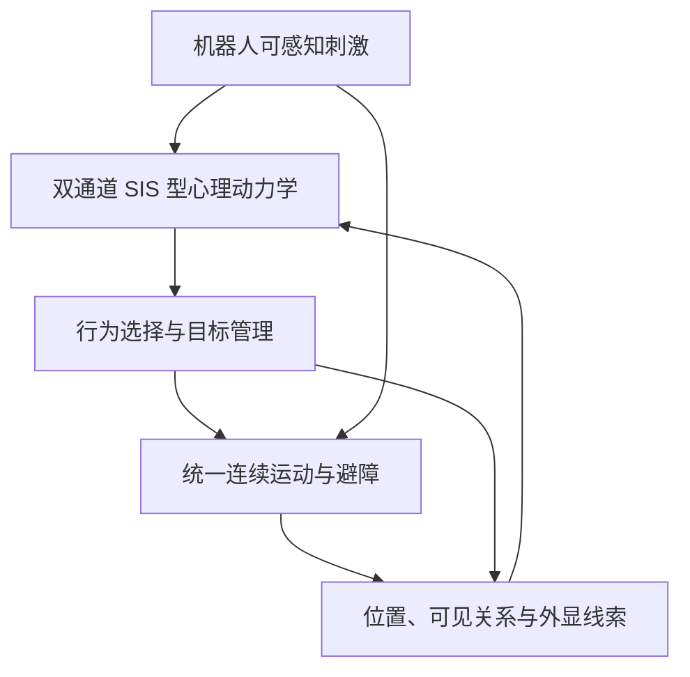

# 多机器人动态心理人群模型：Codex 执行计划

版本：v1.0  
日期：2026-10-12  
目标仓库：<https://github.com/lpc-robotics/multi-robot-crowd-nav>  
编写时核对的提交：`02dfc6d4ca50984a57cdf6f36ce75e0bbfc957db`

> 给执行本计划的 Codex：请在目标仓库中完成本文首版范围内的代码、配置、测试与文档，实现可运行的动态心理人群模型。先核对实际代码与本文基线的差异，再按里程碑推进。不要只给建议，不要把计划中的拟新增接口误认为已经存在，也不要为了演示而脚本化行人的心理或行为切换。条件不足的 ROS/Isaac 验证必须明确标记未执行，继续完成能在当前环境验证的部分。

> **用户明确要求，优先于本文其他一般建议：正常普通心理的人类必须以执行时用户最新 `multi-robot-crowd-nav` 项目中已经设计的 `multi_sfm` regular 行人为基线。不得使用、移植或切换回原 HuNav 项目的 regular 行人实现。原 HuNav 只供参考 curious/scared 的行为语义，不能作为正常心理的运动后端。本文提交号仅是编写时参考；执行前以用户当前工作区的最新实际设计重新核对，不擅自覆盖或回退新代码。**

## 1. 任务目标与研究边界

建立以下闭环：



首版必须能够在合适的实验条件下产生：

1. A 首次观察到低威胁机器人，兴趣积累，从常规任务转为好奇接近。
2. 机器人改变运动，使其相对接近与预计间距构成威胁；A 中断接近并远离。
3. B 观察到 A 的外显反应而提高警戒；B 不会因此自动知道隐藏机器人的真实位置。
4. 人的运动改变有向观察网络，使影响继续传播、减弱或中断。
5. 直接刺激和社会输入下降，心理恢复与兴趣消退占优后，行人接续原任务。

这是一组用于验证机制的候选结果，不是所有行人都必须执行的固定剧情。允许无兴趣、没有恐惧切换、只有轻度警戒、再次接近、延迟恢复等合理分支。

### 1.1 固定首版范围

- 连续心理状态：好奇 `curiosity` 与恐惧/威胁警觉 `fear`。
- 三种动作模式：`REGULAR`、`CURIOUS`、`SCARED`。
- 轻度警戒：独立的 `vigilant` 标志及连续速度调节，不必新增第四种动作模式。
- 双通道 SIS 型激活、传播与恢复；恐惧抑制好奇。
- 逐机器人刺激、熟悉度、观察记忆和目标选择。
- 基于距离及 FOV 的时变有向人际传播图。
- 首版只验证已知无遮挡的开阔场地；不声称实现了墙体或人体遮挡。
- 使用确定性状态机选择行为；无需首版引入 BehaviorTree.CPP 依赖。
- 统一调用本仓库运动核心，只有一套权威行人状态和一次位置积分。
- 先 CPU，再独立 ROS 服务，最后 Isaac；先一机两人，再双机六人。

### 1.2 本次不做

- 不开发新的 MPC、MARL 或多机器人协同导航算法；保留 Nav2/外部机器人控制。
- 不把 NC 论文的驱赶方程直接替换为人群导航方程，不实现完整连续场 PDE。
- 不同时实现 `threatening`、复杂群体关系、声音传播、自然语言沟通或真实情绪识别。
- 不把好奇、恐惧通道解释为已被真人数据验证的心理规律。
- 不将行人轨迹上的合理现象当成行为学有效性的证明。

传染病动力学在这里提供“激活—传播—恢复—再次激活”的结构。首版是带外部源和跨通道抑制的 SIS 型连续模型，并非未经修改的经典随机二状态 SIS。

## 2. 开始前必须核对的仓库事实

先读取适用的 `AGENTS.md`、`README.md`、`docs/MULTI_SFM.md`、接口和测试。记录实际提交、工作区已有修改、运行依赖及可用验证环境。不得覆盖用户未提交的工作。

编写时确认的关键文件：

| 文件 | 当前职责与限制 |
|---|---|
| `src/arena_multi_hunav/arena_multi_hunav/psychology.py` | 纯事务心理协议、`MentalState`、倍率、快照回滚；只有 `noop` 注册；`Entity` 尚无 yaw |
| `src/arena_multi_hunav/arena_multi_hunav/multi_adapter.py` | 共同时间快照、候选提交、服务调用；模型初始化仍传 `{}` |
| `src/arena_multi_hunav_core/src/core.cpp` | 无状态求力与积分；要求 `behavior.type == 1`；只支持普通无分组行人 |
| `src/arena_multi_hunav_core/include/arena_multi_hunav_core/core.hpp` | 独立物理参数、FOV、速度与加速度上限 |
| `src/arena_multi_hunav_msgs/msg/BehaviorModifiers.msg` | `speed/social/robot/space` 倍率；无目标或模式接口 |
| `src/arena_multi_hunav_msgs/srv/ComputeMultiAgents.srv` | v1 求力积分服务；无行为意图 |
| `config/scenarios/` | 场景、机器人控制方式与心理模型名 |
| `src/arena_multi_control/`、`src/arena_multi_bringup/` | 场景校验、参数与 launch 传递，需追踪心理配置入口 |

重要约束：

- 不直接把现有 `behavior.type` 改成 HuNav 的 4/5 并期待核心自动执行 frightened/curious 行为；目前会被拒绝。
- `space_scale` 当前不影响运动，不得将其重新连接到实体半径或近距离排斥。
- 心理插件只能返回候选状态与意图，不能发布机器人速度、直接移动行人或修改物理包络。
- `legacy_hunav` 及其行为树继续走原链路；本任务扩展 `multi_sfm`，不同时启动两套行人积分器。
- 原有 FOV、near 的 CPU/ROS 记录与 Isaac 验收范围不同，不得挪用旧证据宣称新代码通过。

若实际提交已有部分能力，复用并补齐测试，不重复创建同功能模块。禁止通过改写基线摘要或放宽旧测试阈值掩盖退化。

### 2.1 正常心理基线的唯一来源与退化契约

本节落实用户要求，是必须通过的验收项。

- **正常普通心理基线**：用户最新项目已有的 regular 行人，包括其多机器人共同作用、逐对FOV、独立near、目标和障碍项、人际社会项、速度/加速度限制、朝向处理、共同时间快照和任务推进语义。
- 正常心理表示 c/f 处于配置基线、无警戒、无特殊行为意图；它不是原 HuNav 的 `regular` 类或 `BTRegularNav.xml` 的别名。
- `REGULAR + vigilant` 只是复用本项目常规任务运动的轻度警戒动作，应在日志中明确其心理已偏离正常；不能把它混报成完全正常心理。
- 不拷贝、调用或新接入上游 `RegularNav`、`BTRegularNav.xml`、原 HuNav regular 服务来实现本模块的正常状态或恢复路径。
- 不把最新项目的多机普通行人替换为只对单台参考机器人反应的上游行为。
- 不另造“更简单的普通社会力行人”作为无心理对照；直接复用用户当前基线。
- 正常分支应复用现有核心函数或其保持数值语义的抽取版本，不复制一份可能随后分叉的regular算法。
- `noop`、显式关闭心理模型、以及没有有效行为覆盖的中性REGULAR意图，必须在相同物理状态、相同机器人输入和相同配置下退化到本项目基线。
- 从CURIOUS/SCARED恢复时，在恢复后的实际位置、速度和原任务进度上重新使用本项目regular动力学；不瞬移回旧轨迹，也不声称必须与未受扰动整段轨迹重合。
- 本节不要求删除或改写原有 `legacy_hunav` 独立场景；只要求它不进入本次心理人群模型的数据流及正常基线。

开始改动前冻结用户最新regular的代码/配置摘要与代表性输入输出。完成后运行同状态单步等价和同输入多步noop回归。若实际基线较本文参考提交更新，以新的已核对基线建立对照，不以本文旧提交强行覆盖。

## 3. 状态设计：心理、动作、知识与任务分开

以下类型是拟新增设计，可在保持语义的前提下调整命名。

### 3.1 每名行人的连续与离散状态

```text
PsychologicalState
  curiosity: float in [0, 1]
  fear: float in [0, 1]
  traits: validated, immutable per-agent parameters

BehaviorState
  mode: REGULAR | CURIOUS | SCARED
  vigilant: bool
  mode_enter_stamp_ns: int
  interest_robot_id: optional robot id
  threat_robot_id: optional robot id
  target_selection_stamp_ns: int
  transition_reason: enum/string

RobotMemory[robot_id]
  ever_observed: bool
  last_seen_stamp_ns: int
  last_seen_position, last_seen_velocity
  novelty: float in [0, 1]
  confidence: computed from observation age

TaskState
  original task goals and current progress
  temporary behavior intent (separate from task goal queue)
```

- `curiosity`、`fear` 是连续激活程度，不是概率；不要求二者之和为 1。
- 性格是参数差异，不是永久行为标签。
- `regular` 不等于心理状态为零；轻度警戒可以保留常规任务。
- 配置允许全体共享参数和逐 agent 覆盖；首版默认无随机噪声。
- 如果启用个体随机参数，必须按 agent id 稳定生成，并把 RNG 和采样结果纳入快照。
- 不把字符串、字典、机器人记忆硬塞入当前 `dict[str, float]`；新增版本化结构并更新序列化和验证。

### 3.2 知识边界

运动引擎可使用场景几何真值计算避碰，这不意味着心理层能够感知全部对象。

- 心理与行为目标选择只读取“当步可见机器人”和“自身有效历史观察”。
- 不可见机器人实时位置、速度不得用于更新记忆、刺激或方向性行为意图。
- B 看到 A 的恐惧线索，只提高警觉；首版不通过线索自动传递机器人 id、坐标或危险方向。
- 不知道威胁来源时使用 `REGULAR + vigilant`，不能凭全局最近机器人生成准确逃离方向。
- `last_seen` 外推只能使用已观察速度和观察年龄，必须限时、限置信度；不能用当前隐藏真值修正。
- 独立的物理 near 继续按真实几何在所有方位存在。不要将其解释为本次已经实现了听觉。

## 4. 感知、刺激与熟悉度

所有计算使用 `map` 坐标系和同一份步前快照。长度 m，时间 s，速度 m/s，激活程度无量纲，激活/恢复率 s^-1。

### 4.1 可见性

为行人增加 `yaw`，从现有权威状态传入；零速时不能用 `atan2(0,0)` 重置朝向。

机器人视觉权重 V_ir：距离门限乘现有逐对角度权重。复用或严格对齐当前默认总视野 200°、每侧 10° 外缘过渡的语义；本任务不重新争论或修改已配置的 FOV。人际观察权重使用相同形式，但参数分开声明。

- 当遮挡未实现时显式记录 `occlusion_model: none_open_space`，只在无遮挡测试中作行为结论。
- 心理视觉范围与物理力计算范围不同；心理无刺激不等于物理排斥消失。
- 首版不增加独立头部模型。移动时使用运动朝向，静止时保留已有 yaw；无需为“观察动作”伪造独立 gaze。
- 后续若实现静止转向，必须单独定义朝向意图和角速度上限，并同步用于下一步感知。

### 4.2 逐机器人威胁评分

对于当步可观察的机器人 r，设：

\[
\mathbf d_{ir}=\mathbf p_r-\mathbf p_i,
\quad d_{ir}=\|\mathbf d_{ir}\|,
\quad g_{ir}=d_{ir}-r_i-r_r,
\quad \mathbf u_{ir}=\mathbf v_r-\mathbf v_i.
\]

净距 g 与中心距离 d 必须区分。相对接近速度：

\[
v_{close}=\max\left(0,-\frac{\mathbf d_{ir}\cdot\mathbf u_{ir}}{\max(d_{ir},\epsilon)}\right).
\]

首版采用“当前净距 + 常速预测最近接近”的确定性风险函数，避免用距离/机器人绝对速度冒充 TTC：

1. 若 `dot(d,u) >= 0` 或相对速度接近零，预测接近项 P=0。
2. 否则计算 `t_raw = -dot(d,u)/dot(u,u)`；仅当 `0 < t_raw <= prediction_horizon` 才计算预测接近项，超出时域取 P=0。
3. `g_min = norm(d + u*t_raw) - r_i - r_r`。
4. 定义 `clip01(z) = min(1,max(0,z))`：

\[
G=\operatorname{clip01}\frac{g_{warn}-g}{g_{warn}-g_{critical}},
\quad A=\operatorname{clip01}\frac{v_{close}}{v_{close,ref}},
\]
\[
P=\operatorname{clip01}\frac{g_{pred,warn}-g_{min}}{g_{pred,warn}-g_{critical}}
\left(1-\frac{t_{raw}}{T_{pred}}\right),
\quad R_{ir}=\operatorname{clip01}\left(G+(1-G)PA\right).
\]

所有分母及范围在配置加载时校验；中心重合必须有限处理，当前净距项取高风险，不引入 NaN。

`R_ir` 是待校准的工程风险代理，不是真实恐惧量。它应满足：慢速贴近仍能产生风险，远处快速驶离不因绝对速度大而自动产生强刺激。

对当步可见机器人的直接恐惧输入进行有界合成：

\[
s_i^F=1-\prod_{r\in\mathcal V_i}(1-V_{ir}R_{ir}).
\]

空集合取 0。首版记忆只用于维持短时目标知识，不额外产生一套重复的直接刺激；已有 fear 的衰减体现失去视野后的心理持续性。历史威胁持续输入如需增加，留作有独立消融的后续版本。

### 4.3 好奇输入与熟悉度

每个首次观察到的机器人，初始化 `novelty = 1`；仅在可见时按累计暴露时间衰减：

\[
n_{ir}^{k+1}=n_{ir}^{k}\exp(-\eta_i V_{ir}\Delta t).
\]

刺激使用步前 n 值，随后更新 novelty。短时离开视野不将 novelty 重置为 1；同一 trial 内保留已见对象的熟悉度，memory 位置过期不等于清除熟悉度。

好奇直接输入：

\[
s_i^C=(1-s_i^F)\left[1-\prod_{r\in\mathcal V_i}(1-V_{ir}n_{ir})\right].
\]

这是低威胁新颖性驱动的首版假设，不引入“低速必然好奇”的硬规则。目标机器人兴趣分数可取 `V_ir * n_ir * (1-R_ir)`。

## 5. 动态人际网络与可观察线索

约定 w_ij 表示 j 影响 i，即边 j→i。禁止 source/target 方向混用。

原始边权：

\[
\bar w_{ij}=\mathbf 1_{i\ne j}\,\mathbf 1_{d_{ij}<R_{spread}}
\left(1-\frac{d_{ij}}{R_{spread}}\right)^2 V_{i\leftarrow j}O_{ij}.
\]

首版 `O_ij=1`，仅限无遮挡场景。采用有界接收权重：

\[
w_{ij}=\frac{\bar w_{ij}}{\max(1,\sum_{l\ne i}\bar w_{il})}.
\]

这样弱小边不会因单邻居而被强制放大到 1，且每行权重和不超过 1。此选择限制了高邻居数量下的总输入；明确记录其假设，不据此声称研究了所有密度放大效应。非归一化传播留作后续可控对照。

首版提供显式的“外显线索代理”接口：

- `y_C = expressivity_C * curiosity`，仅 `CURIOUS` 时对外发出；其他模式为 0。
- `y_F = expressivity_F * fear`，`SCARED` 时发出完整线索。
- `REGULAR + vigilant` 时可发出 `vigilant_expression_scale * expressivity_F * fear`；其他情况为 0。
- 所有 expressivity 与 scale 位于 [0,1]，因此 `0 <= y_C <= curiosity`、`0 <= y_F <= fear`。
- 接收方只能使用其可见邻居的线索；不能直接遍历全体 mental state 求感染项。
- 线索代理由潜在状态驱动，是明确声明的简化外显模型；尚非从真实姿态、面部或视频中识别的情绪。
- 先使用步前已提交模式与心理状态生成全体线索，不能使用某个先更新行人的本步新状态传播给后更新行人。

预留替换线索模块的接口，后续可用急停、后退、朝向和姿态生成线索。首版不要同时开发视觉识别或修改人物动画资产。

## 6. 双通道 SIS 型动力学与数值更新

对每名行人：

\[
\lambda_i^C=\alpha_i^C s_i^C+\beta_i^C\sum_{j\ne i}w_{ij}y_j^C,
\quad
\lambda_i^F=\alpha_i^F s_i^F+\beta_i^F\sum_{j\ne i}w_{ij}y_j^F.
\]

\[
\dot c_i=(1-c_i)\lambda_i^C-\mu_i^C c_i-\kappa_i f_i c_i,
\quad
\dot f_i=(1-f_i)\lambda_i^F-\mu_i^F f_i.
\]

参数均有限且非负，恢复率为正。连续模型在边界处指向 [0,1] 内，但数值实现仍须保证有界。

### 6.1 使用冻结输入的指数更新

每个步长内从共同步前状态计算全部 lambda，并令 `d_C = mu_C + kappa*f_old`、`d_F = mu_F`。两个通道分别执行：

\[
z_{new}=z_{eq}+(z_{old}-z_{eq})\exp[-(\lambda+d)\Delta t],
\quad z_{eq}=\frac{\lambda}{\lambda+d}.
\]

当 `lambda+d=0` 时保持原值。使用稳定的浮点实现；只允许浮点容差范围内的最终夹紧，明显越界应报错，不能依靠粗暴 clip 掩盖错误。

这是对冻结系数子问题的精确更新，对完整耦合模型仍是一阶时间离散；不得描述成整个非线性系统的精确解。沿用 0.025 s 仿真步长，并以步长减半检查具体实验的收敛性。

### 6.2 必须记录贡献

每步记录直接输入、邻居输入、lambda、恢复率、抑制项和新旧状态。若输出导数分项，明确是步前瞬时导数；它们乘 dt 不必严格等于指数更新的实际增量，二者不得混报。

### 6.3 恢复条件

机器人离开不保证全体立即恢复。默认参数使用 `beta_F < mu_F`、`beta_C < mu_C` 且接收权重行和<=1、线索不大于激活状态，以便在直接输入消失后具有保守的衰减基础。对异质参数按每名接收者检查相应关系。

研究传播持续性时可以单独运行高传播参数配置，但不得拿它作为默认恢复验收失败后的调试借口；也不得在机器人减速事件中直接清零心理状态。

## 7. 行为选择、目标知识与任务恢复

### 7.1 模式优先级

建议按下列顺序实现确定性状态机：

1. 对已知威胁的紧急风险响应。
2. 高恐惧下的定向远离。
3. 低威胁下的好奇接近。
4. 原任务导航，可带轻度警戒。

模式是动作输出，不是心理变量的别名。因紧急风险进入 `SCARED` 时，不强制把 fear 写成高值，日志记录 `emergency_override`。

### 7.2 切换规则

| 情形 | 首版规则 |
|---|---|
| 进入 SCARED | fear>=fear_on 且存在可用威胁知识；或可见机器人风险>=emergency_risk |
| 保持 SCARED | fear>fear_off 且威胁知识有效；退出需满足最小非紧急保持时间 |
| 无来源的高恐惧 | REGULAR + vigilant；不生成指向未知机器人的逃离意图 |
| 进入 CURIOUS | curiosity>=curiosity_on、fear<=fear_off、s_F<=curiosity_max_risk，且存在当步可见兴趣目标 |
| 保持 CURIOUS | curiosity>curiosity_off、没有更高优先级风险、目标有效；短时遮蔽可使用有界观察记忆 |
| 退出 CURIOUS | 兴趣消退、风险提高、目标知识过期；高风险和无效目标不受最小保持时间阻挡 |
| REGULAR 警戒 | fear>=vigilance_on 时开启，fear<=vigilance_off 时关闭 |

必须满足 `0 <= off < on <= 1`。检查模式切换是否允许 `REGULAR→SCARED`、`CURIOUS→REGULAR`，不能限定为固定三阶段循环。

单独处理“风险略升高但 fear 尚未越过 scared 门限”的情况：立即停止继续好奇接近，回到谨慎任务动作；物理避障不等待心理积累。

### 7.3 多机器人目标选择

- 兴趣目标：在可见机器人中按兴趣分数选一个，不对所有机器人同时生成吸引。
- 威胁目标：在可见或有效记忆中的威胁对象中选择主要目标；记忆风险只能由最后观察状态外推计算。
- 对当前目标设置切换优势阈值和保持时间；平分时按稳定 id 排序。
- 急迫的更高风险可打断目标保持时间。
- 所有可感知机器人的威胁均参与好奇禁止条件；不能只看兴趣目标本身。
- 不把带正负号的“好奇减恐惧”简单相减作为总状态或总风险。

### 7.4 观察记忆

- 新可见观察覆盖 last_seen。
- 不可见时只基于 last_seen 做限时外推；置信度 `exp(-age/memory_tau)`。
- 位置外推最多使用 `min(age, memory_prediction_horizon)`；过 TTL 或低于置信门限后目标不可用。
- 目标过期不清零 c/f，也不清除同一 trial 的 novelty。
- 首版不从邻居情绪自动推断机器人身份，不实现虚构的“心理广播坐标”。

### 7.5 原任务恢复

- 原任务队列与当前进度始终保留为权威任务状态。
- CURIOUS/SCARED 的临时目标或期望速度不写入原任务队列。
- 特殊模式首版暂停原任务路点推进，即使恰好经过路点也不悄悄完成它。
- REGULAR 恢复后按现有语义继续推进任务；循环任务和末尾目标行为不得退化。
- 若恢复时已在当前路点到达范围内，按正常任务逻辑推进一次，不重复弹出或重复循环。

## 8. 行为意图与连续运动

### 8.1 意图语义

建议新增 `BehaviorIntent`，至少包含：

```text
agent_id
mode                       # 独立枚举，不复用旧 HuNav behavior.type 数值
vigilant
has_target_robot
target_robot_id             # has_target=false 时不得使用
override_desired_velocity
desired_velocity_x/y        # map 坐标，m/s
allow_task_progress
```

`has_target_robot` 只用于语义检查与诊断。核心不能根据它查询真实 robot position 并重新推导心理意图；方向性意图已经由感知/记忆层生成。核心仍可读取全部实体几何计算原有机械排斥。

目标、记忆及模式变更原因通过版本化心理日志输出，不要求把全部研究状态塞入 ROS 消息。

### 8.2 三种模式如何运动

**REGULAR**：默认完全沿用用户最新项目 `multi_sfm` regular 的目标力、路径目标、全部人机/人际作用与倍率语义；严禁调用上游HuNav regular。vigilant 时只对基准期望速度做有界调节；不要逐步累乘倍率。

**CURIOUS**：根据已知兴趣目标的当前位置或有效记忆预测，产生有限速度的接近意图；在目标净距附近保持一个容差带。使用 `curiosity_standoff_gap`，不要误当成中心距离。可采用 `v_cmd = clip(k_gap*(gap-standoff), -retreat_cap, curiosity_speed)` 沿目标方向生成期望速度，并在停留容差带内令期望速度为零。机器人移动时目标随观察更新，过期时退出。

**SCARED**：根据已知威胁方向生成有限速度的远离意图；达到配置心理安全间距后减小或停止远离，等待状态恢复或风险变化。不要求一直逃跑，也不允许穿墙或忽略另一台机器人。多威胁向量相消、狭窄空间等极端局面记录为首版边界，不宣称全局逃生规划。

未知威胁来源时不执行以上定向远离；采用 REGULAR + vigilant。

### 8.3 求力与积分契约

普通分支保持现有算法。覆盖期望速度时，只替换目标驱动力：

\[
\mathbf F_{desired}=k_{goal}(\mathbf v_{cmd}-\mathbf v)/\tau.
\]

`k_goal` 和 `tau` 读取并复用现有 LightSFM 定义，先核对代码，不另造重复的目标加速度。

随后仍叠加现有障碍、人际社会项、逐对人机社会项和 near。首版特殊模式不额外再加一套同义的趋近/逃离力，避免重复作用。社会力心理倍率可保留为受限输出，首版默认 1，后续需要时独立消融。

- 不能把社会力乘负数来代替接近目标。
- near 不乘任何心理、行为、可见性或目标选择系数。
- 实体半径、物理 clearance、near_gain、near_sigma、硬速度/加速度上限不随心理变化。
- 期望速度为零表示希望减速，不表示把当前速度瞬时清零；near 仍应能推动个体。
- 检查 LightSFM 是否把 desiredVelocity 同时用作硬速度上限。覆盖分支不能用 `norm(v_cmd)=0` 抹去所有动力学。
- 必要时覆盖分支使用受限加速度的半隐式 Euler：`v_next=limit(v+dt*a,max_speed)`、`p_next=p+dt*v_next`；明确其与普通分支的差异。
- 每步恰好一次位置积分；不得同时调用 HuNav 特殊动作中的 updatePosition 和本核心积分。
- 特殊分支不让 LightSFM 的临时 goal 操作泄漏到原任务队列。
- near 是软排斥，不是无碰撞证明；极端不可行初态应在报告中区分。

好奇停留距离要与当前 near 的衰减相容。若接近后始终到不了停留带，先检查单位、目标力和命令逻辑，再校准专用实验的心理停留距离；不要通过心理状态关闭 near。

## 9. 接口升级与兼容策略

首选新增 v2 消息/服务，并保留 v1：

- 新增 `BehaviorIntent.msg`。
- 新增 `ComputeMultiAgentsV2.srv`，沿用 v1 输入输出并增加版本字段和每个行人的 intent。
- v1 端点保持 `/multirobot/hunav/compute_agents`。
- 新端点建议 `/multirobot/hunav/compute_agents_v2`。
- v1 与 v2 共用核心几何/求力实现，避免复制两份物理公式。
- `noop` 原场景继续走 v1；新模型显式走 v2。
- v2 不靠偷改旧 `behavior.type` 分派，使用明确的动态 intent；旧字段作为基准人物配置，输出展示必须以新模式日志为准。
- v2 中每个行人恰好一个 intent；重复、缺失、未知 id、非法模式、非有限命令、越界速度、非机器人 target 必须整笔拒绝。
- CMake/package/export、服务端、适配器、场景解析器和 launch 参数链同步更新。

建议模块布局：

```text
arena_multi_hunav/
  psychology.py                   # 通用协议、注册、验证、v1 兼容
  psychology_models/sis_cf.py      # 双通道动力学与模型状态
  perception.py                   # 感知过滤、风险、熟悉度、观察记忆
  social_cues.py                  # 外显代理与有向邻接
  behavior_policy.py              # 模式、目标选择和运动意图
  multi_adapter.py                # 事务编排、消息转换与发布
```

文件可适度合并，避免为少量代码拆分过多模块；以上职责边界必须保留。不要新增第二个权威行人节点。

## 10. 配置与首版调试值

新增 `psychology_config` 路径，从场景 YAML 经解析器、launch 到适配器；相对路径相对场景文件解析。新增配置版本、未知键拒绝、有限值检查、范围检查和模型注册白名单。禁止任意动态 import。

以下值仅是可执行调试起点，不是实验标定结果。调参后保留初始值、修改原因和配置哈希。所有演示值必须通过对应场景校准，不能保证不调参就产生目标时序。

| 配置 | 初始值 | 单位/说明 |
|---|---:|---|
| model | `sis_cf_v1` | 模型名；配置版本另记 |
| alpha_C / alpha_F | 0.60 / 1.00 | s^-1 |
| beta_C / beta_F | 0.06 / 0.12 | s^-1；默认低于恢复率 |
| mu_C / mu_F | 0.12 / 0.25 | s^-1 |
| fear_inhibits_curiosity | 1.00 | s^-1，即 kappa |
| novelty_decay | 0.05 | s^-1；按可见暴露衰减 |
| expressivity_C / F | 0.8 / 0.8 | [0,1] |
| vigilant_expression_scale | 0.5 | [0,1] |
| robot_visual_range | 8.0 | m |
| spread_range | 3.0 | m，中心距离 |
| robot/human FOV | 200 / 200 | deg，总角度 |
| robot/human FOV fade | 10 / 10 | deg，每侧外缘；与实际 core 配置一致 |
| prediction_horizon | 2.0 | s |
| gap_warn / gap_critical | 0.80 / 0.15 | m，净距 |
| predicted_gap_warn | 0.80 | m，净距 |
| closing_speed_ref | 0.50 | m/s |
| curiosity_on / off | 0.60 / 0.35 | 激活程度 |
| fear_on / off | 0.65 / 0.35 | 激活程度 |
| vigilance_on / off | 0.15 / 0.08 | 激活程度 |
| curiosity_max_risk | 0.25 | 直接威胁输入门限 |
| emergency_risk | 0.85 | 当步可感知风险；可打断行为 |
| min_mode_hold | 0.50 | s；紧急/目标失效不受阻 |
| target_switch_margin | 0.15 | 分数差 |
| target_min_hold | 1.0 | s；紧急可抢占 |
| memory_ttl / tau | 2.0 / 0.8 | s |
| memory_prediction_horizon | 0.75 | s |
| minimum_memory_confidence | 0.2 | [0,1] |
| curiosity_standoff_gap | 0.90 | m，净距；需与 near 一起验证 |
| curiosity_stop_band | 0.15 | m |
| curiosity_speed | 0.35 | m/s，仍受硬限速 |
| curiosity_gap_gain | 0.7 | s^-1 |
| curiosity_retreat_cap | 0.20 | m/s |
| scared_target_gap | 1.50 | m，心理目标净距，不改物理 clearance |
| scared_speed | 0.80 | m/s，仍受核心 max_speed |
| scared_gap_gain | 0.8 | s^-1 |
| vigilant_speed_gain | 0.4 | `speed_scale=1-gain*fear` |

还需明确：初始 c/f 默认0，初始模式 REGULAR，边权归一化方式固定为本文定义，无遮挡标志显式，噪声默认关闭，数值 epsilon 用途分别命名。物理参数从当前 core 配置读取，不在心理文件维护第二份不同的默认值。

为无配置的 `noop` 保留原行为；新模型配置缺失或错误应显式失败，不静默退回 noop。

## 11. 时间、同步、提交与回滚

沿用现有共同时间快照和 `epoch/step` 合同。墙钟只能用于运行超时和健康监控，不能推进心理、记忆、保持时间或兴趣暴露。

每步顺序固定为：

1. 取已提交的全部行人状态、心理状态和共同时间机器人快照。
2. 为全部行人生成步前外显线索、可见关系、直接刺激和传播边。
3. 使用同一份旧状态同步计算全部心理候选值。
4. 计算全部观察记忆、熟悉度、行为和意图候选值。
5. 发送一次 v2 积分请求，输入运动状态仍是步前状态。
6. 对结果检查 epoch、step、时间、身份、有限值、限速、意图覆盖与任务队列变化。
7. 成功后原子提交：运动、心理、模式、目标、记忆、任务进度、RNG 和日志事件。
8. 失败/超时/迟到/时钟回退时，不提交候选状态，沿用现有故障处理。

这是显式的分步耦合方案：先按旧输入推进心理候选，再用候选意图推进同一个运动步。记录该数值约定，不把其描述为连续系统完全同时求解。

特别处理：

- 所有 agent 在同一阶段完成后才进入下一阶段，打乱输入顺序不改变结果。
- 阈值越过发生在一个离散步内，事件时间统一约定为该步结束时间；不虚构亚步精度。
- 输出事件只在提交后发布，失败候选不得产生“幽灵模式切换”。
- 诊断缓存、last_seen、目标保持计时和 novelty 都属于事务状态。
- 给断点快照增加 schema/model/config hash，跨不兼容版本拒绝恢复。
- 场景 reset 清理整套 trial 状态，恢复初值；不能遗留上一轮的 novelty 或目标 id。

## 12. 日志与诊断交付

保留 `/multirobot/hunav/psychology`，升级为显式版本化输出。核心记录至少包括：

- 仿真 stamp、epoch、step、agent id、模型/配置版本。
- c/f 新旧值、直接输入、邻居输入、恢复及抑制项。
- mode、vigilant、进入时间、切换原因。
- 兴趣/威胁目标、知识来源、观察年龄和置信度。
- 可见机器人集合及逐机器人 novelty/risk。
- 稀疏传播边 `source_id,target_id,weight,cue_C,cue_F`。
- 原任务进度、意图速度、实际速度、净距、加速度限幅标志。

现有 interactions 记录的是逐机器人社会项与 near 的合力，不能直接把它当作独立心理刺激。建议新增或版本化分项诊断，保留旧消息兼容性；不要用差分猜测当前 near 数值。

日志支持流式 CSV/JSONL，不在节点中无限累积历史。高频逐对诊断可配置抽样，测试期间能够记录全量。演示颜色可表示模式，不能把改颜色当作实现心理模型。

## 13. 必须完成的测试矩阵

### 13.1 纯心理与感知测试

| 编号 | 测试 | 可检查的通过条件 |
|---|---|---|
| P01 | 无刺激、无邻居、初始为0 | c/f 一直为0，保持 REGULAR |
| P02 | 无输入但初始激活>0 | 与指数恢复解一致；误差在浮点容差内 |
| P03 | 固定单通道常量输入 | 与冻结系数解析更新一致 |
| P04 | 极端有限合法参数与步长 | 状态保持[0,1]，无 NaN/Inf |
| P05 | 恐惧抑制好奇 | 相同好奇输入下，高 fear 的 curiosity 不高于无 fear 对照 |
| P06 | FOV与观察记忆 | 当前刺激按可见性变化；失去视野不清零心理；不更新隐藏位置 |
| P07 | 风险因素 | 慢速贴近有风险；远处快速驶离不因绝对速度产生接近项；横穿近失风险可被检测 |
| P08 | 熟悉度 | 暴露累计后 novelty 下降；短时重现不重置 |
| P09 | 有向传播 | 只改变观察方向即可使 j→i 存在、i→j 不存在 |
| P10 | 传播关闭 | beta=0 时，固定其他输入的邻居心理变化不改变接收者心理 |
| P11 | 没有外显线索 | expressivity=0 时，接收者无该通道传播输入 |
| P12 | 输入顺序 | 改变 agent 列表顺序，按 id 对齐后结果一致 |
| P13 | 步长收敛 | 在平滑固定输入中 dt 与 dt/2 的差异随步长减小；模式事件容许离散步误差 |

解析测试可用 double 的 `atol=1e-10, rtol=1e-8` 起点；ROS float32 与轨迹测试使用独立、说明理由的容差。

### 13.2 行为与多机器人测试

| 编号 | 测试 | 可检查的通过条件 |
|---|---|---|
| B01 | 好奇接近 | 满足触发条件后产生指向已知目标的期望速度，进入停留带而不是无限贴近 |
| B02 | 好奇转恐惧 | 不设置切换时间；由输入与阈值触发；高风险能抢占 CURIOUS |
| B03 | 滞回 | 阈值附近小幅输入变化不导致每步来回切换 |
| B04 | 无来源警戒 | B 只见A不见机器人时可警戒，但无隐藏机器人定向意图 |
| B05 | 获得来源 | B 后续直接观察机器人后，才可选择该机器人作威胁目标 |
| B06 | 不同机器人角色 | 对R1感兴趣、R2构成威胁时，R2能打断接近；不能只检查R1 |
| B07 | 目标保持 | 相近兴趣分数不高频切换；更高紧急风险可抢占 |
| B08 | 记忆过期 | 目标失效后停止使用其方向，不查全局真值续接 |
| B09 | 原任务恢复 | 临时动作不丢失/弹出原路点，恢复与循环队列正确 |
| B10 | 动态邻接 | 运动导致边增删，传播贡献随之变化；边删除不瞬间清除心理 |

### 13.3 核心与事务测试

- 用户最新项目的v1/noop原有回归继续通过；v2中性REGULAR意图与该项目基线在相同状态下保持等价，不能拿原HuNav regular充当参照。
- 恢复测试在特殊行为结束后的实际状态复制一个本项目regular对照，核验下一步动力学与任务推进一致；不要求回到未受扰动的旧轨迹。
- 依赖与调用链审查确认：新增心理链不调用原HuNav regular服务、动作或行为树，不退回单机器人参考。
- 任意合法心理值和模式下，相同几何的 near 分量保持不变；背后 near 有效。
- 期望速度为0时仍经过受限减速与 near 作用，不直接锁死位置。
- 总加速度与实际速度不超过原硬上限，且每步只有一次积分。
- 缺失/重复 intent、错误 target、非法状态或配置应原子失败。
- 故障注入后，比较运动、心理、记忆、模式、任务、RNG 的完整快照，候选均未提交。
- 迟到响应不提交；仿真暂停不增长心理时间；时钟回退沿用保护。
- 输入当前世界存在但对 agent 不可见的机器人位置扰动，不影响其认知意图；测试要避开物理项干扰，分别检查认知输出与机械运动。

这些是模型和事务的关键测试，不为简单转发、命名或低影响改动编写镜像测试。

## 14. 场景、消融与证据

### 14.1 场景递进

1. **冻结观察回放**：只提供固定位置、边、刺激时序，验证传播和恢复，消除轨迹改变造成的混淆。
2. **一机一人**：低威胁新颖刺激、接近风险变化、机器人离开与任务恢复。
3. **一机两人**：A 受直接刺激，B 仅观察 A；B 初期没有机器人观察历史，满足严格的无来源测试。
4. **一机多人**：位置运动造成边断开/重连，记录传播范围与恢复。
5. **双机六人**：两机不同刺激、多目标冲突、同时/错峰通行；沿用已支持的场地和保守速度。

允许脚本控制机器人轨迹作为外部实验输入；禁止在某个固定时刻直接写入行人模式或心理值。不同分支由模型和配置产生。

CPU 大范围机制测试先通过，再将代表场景接入 Isaac。不能为了得到“快速靠近”擅自提高已验证机器人速度上限；先通过相对运动、净距和时间顺序构造风险差异。

### 14.2 必备对照

- 用户最新项目 `multi_sfm` regular 的noop / 无心理动力学；禁止替换为原HuNav regular。
- 有机器人直接刺激但 beta_C=beta_F=0。
- 恐惧传播开启、好奇传播关闭。
- 完整双通道模型。
- 完整模型但固定观察网络，用于隔离拓扑反馈。

固定网络是实验性回放/消融，不是正式感知逻辑；明确标记，不能让固定边凭空传递不可观察的实时信息并称之为真实感知。

所有对照记录相同初始状态、机器人输入、参数差异和种子。冻结回放用于机制归因，释放运动后的差异用于闭环研究，两种结论分开。

### 14.3 输出与验收

至少输出：

- A/B 的 c/f 随时间曲线，标注模式与触发原因。
- 轨迹、机器人刺激和原任务进度对照。
- 关键传播边及各时段邻居输入。
- 模式切换次数、停留时长、返回任务时间。
- 最小几何净距、碰撞/重叠次数、硬限幅触发率。
- 相对 noop 的任务延误、累计恐惧 `integral(sum(f_i) dt)`、受影响人数及恢复时间。
- 同时/错峰实验必须同时报告机器人完成时间，不预设错峰一定更好。

工程验收：所有硬约束、事务、知识边界和回归测试通过。代表性可行场景无几何重叠，并满足冻结的项目安全阈值；若旧场景规定0.10 m净距，不得悄悄降低它。结果不佳应检查意图、几何与参数，而不是删除失败案例。

科研现象验收：不是要求每组种子都演出同一个故事，而是关键机制在各自受控场景中可重复、可关闭、可解释。默认恢复场景在外部及社会输入足够弱后恢复；高传播研究配置允许不同结局，但要独立报告。

正式批量实验之前冻结配置与种子集；调参种子与验收种子分开，复用现有种子约定时先核对。禁止在测试代码中断言预先编排的准确切换秒数。

## 15. 分阶段执行清单与退出条件

### M0：基线与实施设计

- [ ] 核对实际版本、AGENTS、未提交修改、v1接口、现有测试和环境。
- [ ] 冻结用户最新regular基线，写明其来源与调用链，确认不是原HuNav regular。
- [ ] 绘制新旧调用链，确定v2服务、心理配置和日志版本。
- [ ] 记录基线命令、结果与未具备的运行条件。
- [ ] 不改 underlay、旧发布目录及旧证据文件。

退出条件：能够说明在哪里接入新状态、哪里只积分一次、怎样保留 noop。

### M1：纯 Python 心理动力学

- [ ] 完成状态类型、配置校验、双通道方程、外显代理与同步更新。
- [ ] 完成感知、风险、novelty和记忆模块。
- [ ] 通过P01–P13及不可见真值隔离测试。
- [ ] 输出冻结回放的状态、来源和恢复曲线。

退出条件：模型可在无ROS/无GPU环境运行；状态有界、结果可复现。

### M2：行为模式与意图

- [ ] 完成模式滞回、优先级、目标保持和无来源警戒。
- [ ] 完成三种模式的意图生成和任务恢复协议。
- [ ] 通过B01–B09的纯逻辑/CPU测试。

退出条件：同一人可由输入触发不同模式，且不依赖手写切换时刻。

### M3：v2 核心与ROS事务接入

- [ ] 新增消息/服务，复用原物理实现。
- [ ] 加入目标驱动力覆盖与一次积分，处理desiredVelocity兼作限速的风险。
- [ ] 接通场景配置、模型注册、yaw、候选状态与原子提交。
- [ ] 通过near不变、noop回归、任务队列、失败回滚和独立ROS服务测试。

退出条件：真实服务链可返回受心理驱动的运动，旧场景不退化。

### M4：闭环CPU机制与消融

- [ ] 跑通一机一人、一机两人、移动邻接和双机目标冲突。
- [ ] 完成传播关闭、单通道和固定网络对照。
- [ ] 记录失败情形、参数调整和非预期行为。
- [ ] 冻结首版参数和待验证场景。

退出条件：因果链可解释，日志能定位直接刺激、传播和行为选择各自的作用。

### M5：Isaac代表场景与交付

- [ ] 在可用GPU环境中验证实际角色运动、时间同步、停止与任务恢复。
- [ ] 先一机两人，再双机六人；不直接扩大到高密度大场景。
- [ ] 生成首版报告、图表、复现命令和证据清单。
- [ ] 若环境不具备，明确列为未执行，不宣称完整运行验收。

退出条件：代码实现、自动测试和实际运行证据分别可核验；不以视频代替测试。

完成当前里程碑后继续下一项，不为例行命名、目录选择或已授权的可逆实现反复询问。出现会改变研究语义的选择时，先执行本文默认方案并在决策记录中说明；若与实际约束不可兼容，才报告明确阻碍。

## 16. 最终交付物与完成定义

执行Codex应交付：

1. 可构建的代码修改，模型名 `sis_cf_v1` 可从场景选择。
2. 版本化心理配置、最小复现场景及机器人输入脚本。
3. 自动测试与实际执行结果；无法运行的测试附原因。
4. `docs/DYNAMIC_PSYCHOLOGY.md`：状态语义、方程、配置、模式规则、边界和复现步骤。
5. 新建证据目录，保存配置/源码摘要、日志、对照图和报告，不覆盖历史验收。
6. 变更摘要：改了什么、为何这样设计、已验证范围、已知限制和后续事项。

完成定义：

- [ ] 不是只有结构体、接口占位或改颜色，而是实际运动随模型变化。
- [ ] 不是只有恐惧传播，好奇通道、熟悉度及好奇接近也可独立工作。
- [ ] 不是直接改behavior.type，而是完整的模式、意图、求力与任务恢复链。
- [ ] 心理层无隐藏位置泄漏，传播使用可见线索，未知威胁不定向逃离。
- [ ] 近距离项与心理独立，硬物理上限和原no-op回归保留。
- [ ] 正常心理、noop对照、特殊行为恢复全部使用用户最新项目的regular；没有接入原HuNav regular。
- [ ] 心理、运动、模式、记忆和任务进度同事务提交与回滚。
- [ ] 传播、恢复、动态邻接与多机器人目标冲突均有可复现证据。
- [ ] 没有把仿真现象说成真实人类行为已经验证。

本计划要求本地实现、验证和准备可审查的改动；不自动推送远端、不覆盖正式发布、不替用户发布研究结论。若需提交或发布，按后续会话中的明确授权执行。

## 17. 后续扩展与本阶段停止点

首版完成后固定模型v1，开始比较现有Nav2与后续交互感知规划；不要无限扩展仿真功能。

后续再考虑：真实/实验数据校准、基于运动线索的情绪推断、威胁信息传播、遮挡与听觉、独立头部朝向、不同恐惧反应、群体关系、非归一化传播、心理状态估计误差，以及离散人群到连续/介观场的推导。

与NC文章衔接时，先统计密度、速度、行为模式和心理激活的空间分布。由轨迹核平滑得到场只是统计表示，不能宣称已经推导出闭合预测PDE。行为模式人数比例与c/f激活强度也必须分开统计，不能因为c_i是0.7就当作0.7个人处于CURIOUS。

## 18. 已核对来源与术语说明

- 当前工程基线：[multi-robot-crowd-nav，02dfc6d](https://github.com/lpc-robotics/multi-robot-crowd-nav/tree/02dfc6d4ca50984a57cdf6f36ce75e0bbfc957db)。
- 当前心理协议：[psychology.py](https://github.com/lpc-robotics/multi-robot-crowd-nav/blob/02dfc6d4ca50984a57cdf6f36ce75e0bbfc957db/src/arena_multi_hunav/arena_multi_hunav/psychology.py)。
- 当前积分核心：[core.cpp](https://github.com/lpc-robotics/multi-robot-crowd-nav/blob/02dfc6d4ca50984a57cdf6f36ce75e0bbfc957db/src/arena_multi_hunav_core/src/core.cpp)。
- HuNav官方行为语义与行为树：[README](https://github.com/robotics-upo/hunav_sim/blob/35c2d81fc0e8166a3d124558fd718dd03e8a914c/README.md)。本计划借鉴行为原语，不原样调用上游可能自带积分和墙钟计时的动作。
- HuNav论文：[HuNavSim: A ROS 2 Human Navigation Simulator for Benchmarking Human-Aware Robot Navigation](https://arxiv.org/abs/2305.01303)。
- SIS与情绪传播已有研究：[A method of emotion contagion for crowd evacuation](https://doi.org/10.1016/j.physa.2017.04.137)。本文双通道方程、参数和认知边界是为当前项目提出的实现设计，不是该文公式的直接复刻。
- 微观—宏观理论参考：[Nonreciprocal field theory for decision-making in multi-agent control systems](https://doi.org/10.1038/s41467-025-63071-4)。本文不声称已将其场论直接迁移为心理人群模型。

术语：`scared` 表示动作模式，`fear` 表示连续激活程度，`risk` 表示外部几何/运动风险代理，三者不可混用；`curious`、`curiosity`、`novelty` 同理。
