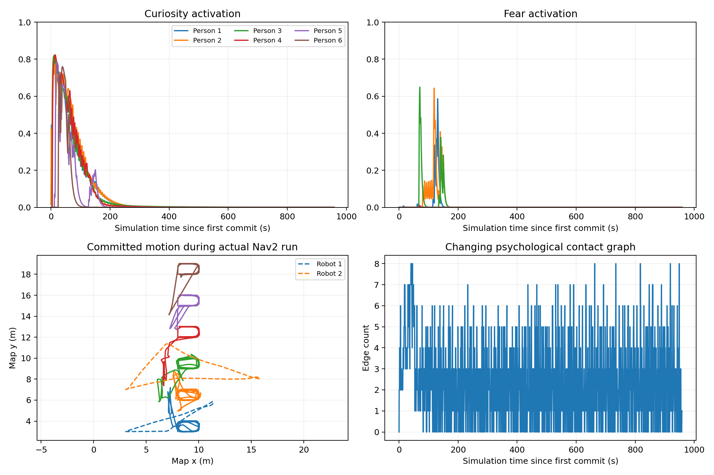
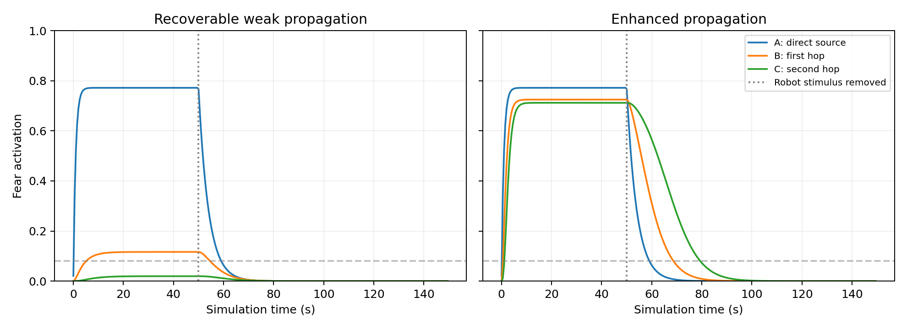
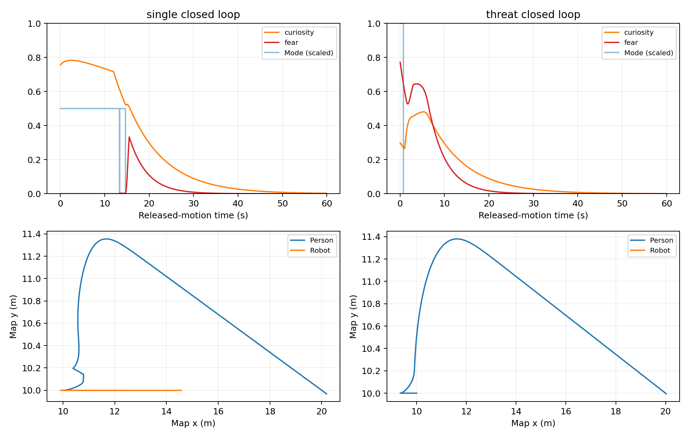
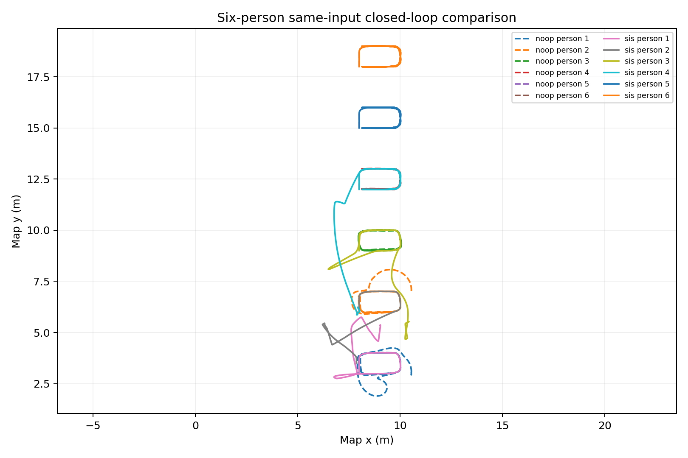

# 动态心理模型开发与验收

日期2026-10-12；2026-10-13继续复查与重验；模型sis_cf_v1；开发分支feature/dynamic-psychology-v1。
这是工程与机制验收，不是实证心理规律验证，也未创建正式release。

## 版本保护

开始时HEAD cd0ab07，有未提交多目标成果。完整备份位于
`/home/lpc/workspace/arena5_multi_backups/20261012T101728Z-before-dynamic-psychology`，
解包后10,147条目一致。现有成果保存为独立提交1301b05、标签backup-psychology-20261012。
underlay保持原基线，原场景及旧证据保留。
实现与文档保存为本地提交`e422603`；验收证据单独提交，未推送远端。

## 已执行检查

|检查|结果/报告|
|---|---|
|隔离overlay构建|7包通过，validation/build.log|
|离线验证|116项Python、29项C++、配置/接口/vendor/underlay通过，validation/offline.json|
|原普通核心精确回归|24,000步逐字段完全相同，validation/regular_baseline.json|
|模型与真实v2服务CPU闭环|通过，validation/cpu/cpu.json|
|真实适配器故障注入|5类通过，validation/faults/faults.json|
|一机两人Isaac|120秒墙钟通过，validation/isaac_two_people.json|
|实际双机器人Nav2自动任务|3轮、6个目标均成功，validation/psychology_demo.json|
|双机六人Isaac耐久|1800.050秒墙钟通过，957.425秒仿真，validation/isaac_six_people_30min.json|

原核心比较使用完整快照中的旧静态库和当前静态库，10组机器人输入×1/6人×1200步，
比较位置、朝向、速度、原目标队列和逐机器人作用；两个输出SHA256完全相同。
比较代码保存在validation/regular_baseline_compare.cpp。

CPU固定链的B/C直接刺激严格为零；默认局部警戒可恢复，增强配置可产生第二跳。
无威胁位置时B/C只警戒，不凭真值远离。单人先进行标注的冻结观察再释放运动，
所有心理激活由模型积分生成；好奇停留、恢复与持续威胁远离分别验收。
六人同机器人输入比较noop和心理，心理分支最小人机净距0.479817米、人际0.544532米；
noop为0.226173米和0.426491米。失败Nav2观测轨迹的120秒回归重放为0.313169米和0.605191米。
这不是任意运动或布局的安全保证。

最终一机两人实际角色检查：120.077秒墙钟、127.450秒仿真，最小人机净距0.956603米，
人际净距0.568546米，最大显示误差0.067496米，3866次暂停队列检查，零失败。

最终双机六人实际角色检查：1800.050秒墙钟、957.425秒仿真，最小人机净距0.290389米，
人际净距0.386764米，最大显示误差0.037520米；19,148个实际角色样本全部匹配，
8176次暂停队列检查，零失败。六人均出现CURIOUS与REGULAR，2、3号还出现SCARED；
三轮、六个实际Nav2目标全部成功。心理行为均由模型生成，任务脚本只控制机器人目标。
自动任务在约190.4秒仿真时间完成；余下耐久区间机器人停留，检查心理衰减、任务恢复与
持续路线运行，并非30分钟持续穿行刺激。完整日志有38,345次连续提交，步号无跳跃，
六人均完成心理干预后的任务回归；本轮局部速度筛选未出现不可行约束。
最终源码摘要为`2f08aca63f58fbf6ed242dd0dfdd132ee45f4da19613a60dd5f228d45646c478`。
运行时HEAD是保护基线1301b05，源码当时尚未提交；报告中的逐文件摘要绑定实际被测实现，
最终acceptance.json中的source_commit对应随后保存的实现提交。

## 保留的失败试验与决策

- cpu_initial：原交叉路线的noop也有行人重叠；心理趋近进一步聚集。没有降低验收阈值。
- calibration_gap_1_5、calibration_gap_2_1：分离任务区后，单纯扩大停留距离仍未消除心理趋近重叠。
- approach_gate_initial：加入基于可见邻居的接近可行性检查后全部CPU门槛通过。
- before_demo_fix：实际启动暴露rclpy.Node的clients只读属性冲突；改用_action_clients，并补真实节点实例化及ROS action门禁测试。
- before_neighbor_fix：实际Nav2六人运行约119秒墙钟后出现重叠，最小人际净距-0.01113米；三轮机器人目标虽全部成功，该轮几何验收仍失败。报告与重建轨迹保留在validation/before_neighbor_fix。
- concurrent_shutdown_stall：另一Isaac验证实例关闭期间出现机器人观测超时，保护锁存、任务取消；该轮几何无重叠仍判失败。保留0.6秒保护阈值，改为单独运行本任务六人场景重新计时。
- endurance_observation_stall：单独运行约833秒墙钟后出现观测/心跳停顿，未达到30分钟；最小人机/人际净距0.294/0.383米，实际观察到SCARED，自动任务成功。这些结果不等于耐久通过。
- environment_reentry_failure：新增同进程测试封装后，重复source环境将ROS_LOCALHOST_ONLY从1改为0，监测器收不到场景消息。已修复overlay环境保留逻辑，旧underlay未改，并加入重复加载检查。

重建积分轨迹定位到2、3号行人：在约81.55秒仿真时间已恢复REGULAR，返回路线交叉，
原好奇可行性检查没有覆盖这段运动。修正增加邻人记忆、回归目标与局部期望速度约束，
并补充循环队列到达后清理回归状态的测试。真实实际角色报告仍作为最终几何依据。
重放输入按原日志last_seen_ns重采样，不把最后观测记录的写入时间当作观察时间；缺失
观测区间采用注明的直线插值。新增原始权威几何日志避免后续仅凭力项重建。

最终保留0.9米观察目标净距，原物理参数不改。新建独立心理路线，保留原多目标路线。
心理高但接近不可行时暂停接近，2秒后重试；配置、日志和测试明确记录此策略。
低速单人自然闭环只出现好奇/警戒/恢复；没有强制将其改为固定三阶段故事。
恐惧远离另用持续威胁受控输入验证。

## 复现与图表

```bash
source scripts/env.sh
ROS_DOMAIN_ID=84 python scripts/validate_psychology_cpu.py --output-dir evidence/runs/psychology/cpu
ROS_DOMAIN_ID=86 python scripts/validate_multi_sfm_faults.py \
  --psychology-config "$PWD/config/psychology/sis_cf_v1.yaml" --output-dir evidence/runs/psychology/faults
python scripts/plot_psychology.py evidence/runs/psychology/cpu --output-dir evidence/runs/psychology/figures
```

真实运行命令见docs/DYNAMIC_PSYCHOLOGY.md和command.txt。GPU查询在沙箱内看不到设备，
沙箱外已核实GPU并执行Isaac。实际验收使用GPU3、ROS域85、独立日志和端口，
关闭流媒体/Foxglove以隔离验收，正常人工入口继续支持现有可视化变量。
最终耐久使用GPU3对应NUMA节点的CPU亲和性`28-55,84-111`，渲染仍为项目默认boring，
观测超时仍为0.6秒。条件见[run_profile.json](validation/run_profile.json)，
复现封装见[run_endurance.sh](validation/run_endurance.sh)，从工作区根目录运行：
`taskset -c 28-55,84-111 bash evidence/dynamic_psychology_20261012/validation/run_endurance.sh`。
CPU亲和性是否是消除前次停顿的原因未经对照验证，不作因果结论。
只读时序监测包含资产加载阶段，启动时约9.15秒消息间隔不能解释为健康验收期故障；
最终健康状态正常，独立实际角色验收零失败，封装退出后已自动清理本次场景。






JSONL高频轨迹保存在本机，报告记录其哈希，Git不收录大型轨迹和运行日志。
实际运行图中的位置来自核心提交记录；Character Graph的实际净距与显示误差以独立
isaac_six_people_30min.json为准。轨迹统计见[actual_trace_summary.json](figures/actual_trace_summary.json)，
原始文件位置与哈希见[artifact_manifest.json](validation/artifact_manifest.json)。
最终acceptance.json检查源码摘要、报告通过状态、报告哈希及30分钟耐久门槛。
