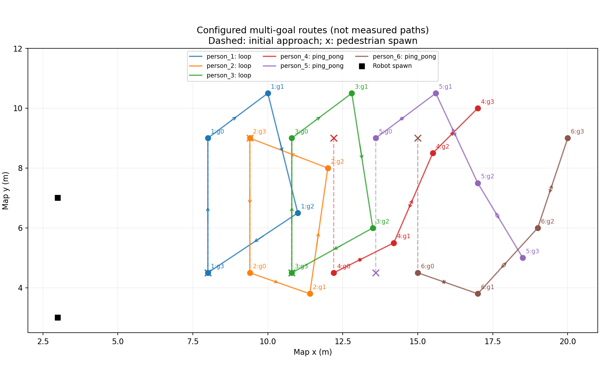

# 多目标点升级验收（2026-10-10 开发，2026-10-11 最终验收）

基线提交 `cd0ab0713abd3b11e4a49d0b39ad09388c8f8706`，保护标签
`backup-multigoal-20261010`，开发分支 `feature/pedestrian-multi-goals`。
完整备份和恢复校验见 [RECOVERY.md](../../docs/RECOVERY.md)。

新场景是 `two_robots_multi_sfm_6_multigoal_nav2.yaml`：三人循环、三人折返，每人四个
基础目标，出生配置和动力学参数沿用原六人场景。生产 C++ 核心、ROS 接口、FOV 参数、
近距离力和 LightSFM vendor 保持原样。

## 验收记录

最终验收通过：[acceptance.json](acceptance.json) 已核对当前源码与各报告摘要一致。
源码摘要为 `681897ddc351610df089b586022440d248720de87b7716269910010a86153d4e`。
实现保存在开发分支的工作树中，尚未提交；报告里的 `source_commit` 是开发基线，具体改动
由 `source_sha256` 及逐文件摘要标识。

| 检查 | 最终结果 |
|---|---|
| 隔离 overlay 构建 | 7 个包通过 |
| [离线检查](validation/offline.json) | 79 项 Python、24 项 C++；配置、FOV/近距离力和 vendor 检查通过 |
| [CPU 路线](validation/cpu_routes.json) | 180 秒仿真，六人完成 12、12、12、11、9、10 个周期 |
| 旧两点轨迹 | 原一人、六人配置各对比 30 秒／1200 步，ROS 编解码后的状态字段逐步一致 |
| [Isaac 长时路线](validation/isaac_routes_30min.json) | 1800.005 秒墙钟／994.925 秒仿真，无失败事件、无锁存故障 |
| Isaac 前 180 秒 | 六人完成 12、13、12、11、9、10 个周期，均超过两周期门槛 |
| Isaac 完整窗口 | 六人完成 66、71、65、63、54、58 个周期；每人 39,798 个连续路线样本 |
| 实际角色检查 | 19,899 个同步样本、零跳过；最大显示误差 0.02814 m，最小人机净距 2.53497 m；速度满足 1 m/s 上限（浮点容差内） |
| [双机导航](validation/navigation.json) | 原导航任务十轮全部通过 |
| 版本保护 | underlay 30 项通过；40 个原配置／生产核心／接口／用户文件未变；安装文件与源码一致 |
| [完整快照恢复](validation/restore_check.json) | 解包后 9,798 个条目一致，归档哈希复核通过 |

验收结束后已通过专用日志目录的 `cleanup.sh` 停止本次仿真进程。
通过结论对应上述采样窗口。以下历史记录不作为最终验收依据：

- `validation/*_initial.*`：配置边界精度检查完成前的初测。双机十轮导航通过，长时探针
  被主动结束，以便重新记录最终代码的完整窗口。
- `validation/before_wire_fix_*`：以 CDR 原始字节比较旧轨迹的检查出现差异。最终检查
  比较经 ROS 编解码后的字段；单元测试通过修改 CDR 的对齐填充字节验证语义相等，同时
  确认真实位置变化仍被检测。
- `validation/source_changed_*`：完成了 1800 秒墙钟运行，运动与健康门槛通过，但由于
  期间更新了 CPU 检查脚本，源码一致性门禁失败。保留失败标记，最终验收重新运行。
  该次仿真在探针结束之后继续运行，后续曾锁存 `robot_stale`；这段窗口不计入验收。

CPU 探针通过真实、独立命名的 ROS 计算服务验证行人运动，机器人固定在出生点。
最终 Isaac 使用 GPU 3、ROS 域 80、独立日志目录 `logs/multigoal_20261011`，关闭流媒体和
Foxglove；实际角色仍由 Character Graph 生成并通过 `actual_people` 验证。
导航使用原有 `two_robot_lanes.yaml`，两机各自往返 (3,3)/(5,3) 与 (3,7)/(5,7)。
这一导航回归不宣称机器人穿越了全部行人路线。

路点到达使用权威位姿和目标半径，实际角色通过同步显示误差验证。循环计数从探针接入时
的完整队列相位开始。逐步样本缺失会失败，不把缺失区间推断成成功到达。
报告中的 `people_at_route_deadline` 对应前 180 秒仿真窗口，`people` 对应完整耐久窗口。

源码摘要包含 src/scripts/config 下已跟踪及新增未跟踪文件，报告同时记录各文件哈希。
源码在验收期间改变会使报告失败。CPU、Isaac、导航和离线结果分别保存，不复用旧发布
报告；本次不创建正式发布包、不改既有 release 验收清单。

完成所有检查后，运行 `python evidence/multigoal_20261010/finalize.py` 生成本次开发验收
清单。它核对当前源码、报告哈希、旧配置和生产核心的保护状态，以及完整周期、30 分钟、
导航十轮和备份恢复结果；任何缺失或失败记录都不能生成通过清单。

## 复现

配置与完整命令见 [PEDESTRIAN_ROUTES.md](../../docs/PEDESTRIAN_ROUTES.md)。
完成构建后，在独立 ROS 域运行 CPU 工具。启动新增 Isaac 场景并等待角色就绪，再同时
运行只读路线耐久工具与双机导航工具。30 分钟门槛是墙钟时间，180 秒路线门槛是仿真时间。

布局图使用 `source scripts/env.sh` 后运行：

```bash
MPLCONFIGDIR=/tmp/arena5-multigoal-matplotlib python evidence/multigoal_20261010/plot_routes.py
```


