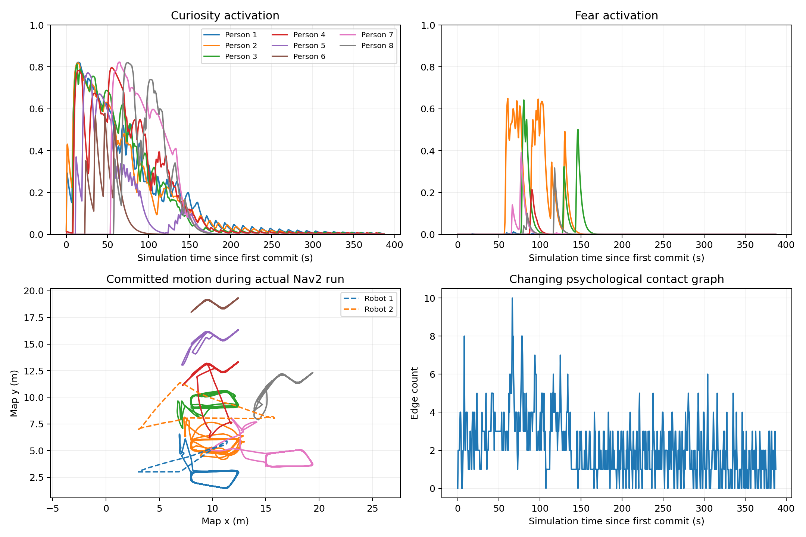
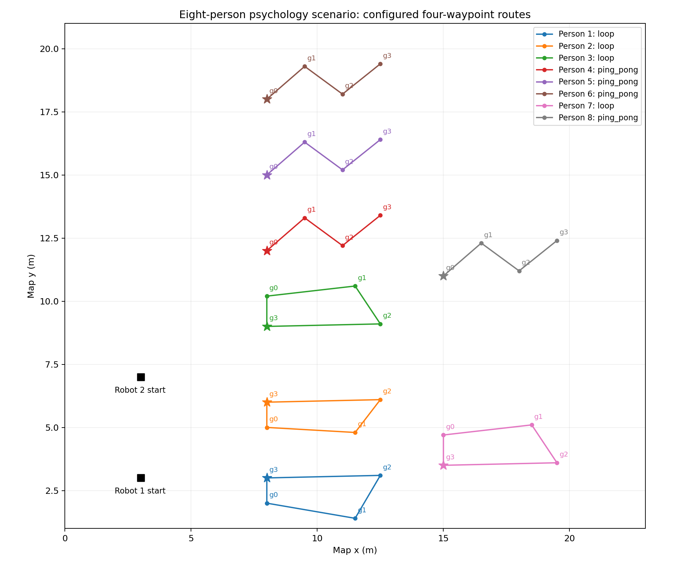

# 八人多目标心理场景验证（2026-10-22）

本次仅调整默认心理场景的路线和人数；SIS模型、心理阈值、物理参数、机器人起点及
三轮自动Nav2任务保持原样。八人现使用独立的`two_robots_multi_sfm_8_multigoal_psychology_nav2.yaml`，原六人入口恢复原配置。
配置与坐标说明见[开发记录](../../docs/PSYCHOLOGY_MULTIGOAL_20261022.md)。

修改前HEAD为`8917fb2`，保护标签为`backup-psychology-routes-20261022`。
旧六人配置、增强传播场景及普通多目标场景保留；历史30分钟结果不套用于新八人布局。
新场景与文档保存为本地提交`ce9cb06`，验收证据单独提交，未推送远端。

## 检查范围

原设置保持情况见[preserved_settings.json](preserved_settings.json)：原六人起点与物理参数、
心理配置、机器人任务及相关旧场景共19项比较通过。

- 离线：130项Python、29项C++、配置、vendor和underlay检查通过，见[offline.json](offline.json)。
- 常规行走：真实私有ROS核心运行180秒仿真，八人均完成至少15个完整周期；
  检查目标到达与顺序、限速/加速度以及旧一人/六人配置成对轨迹兼容，见[regular_routes.json](regular_routes.json)。
- 心理回放：真实v2核心采用旧成功运行前300秒及本次失败运行约75秒的机器人输入，
  两组均通过；最小人际净距分别0.549/0.495米，见[robot_replay.json](robot_replay.json)。
  第一组出现CURIOUS、SCARED与REGULAR，心理值仍由模型产生。
- 实际Isaac：600.055秒墙钟、385.825秒仿真通过，零失败，见[actual.json](actual.json)。
- 实际原任务队列：15,506条连续提交记录逐条核对，八人分别完成30/27/28/25/30/33/27/29个
  完整周期，无跳点、乱序或暂停期间推进，见[routes_actual.json](routes_actual.json)。

## 最终实际结果

|指标|结果|
|---|---|
|实际匹配角色样本|7716，零跳过|
|最小人机净距|0.297153米|
|最小人际净距|0.128074米，无重叠|
|最大显示位置误差|0.052503米|
|心理暂停队列检查|12,968次通过|
|机器人自动任务|原三轮六个目标全部成功，见[psychology_demo.json](psychology_demo.json)|
|心理行为|1/2/3/4/5/7/8号出现好奇和恢复，2/3号还出现恐惧；新增7/8号完成任务回归|

6号有心理激活变化，好奇峰值约0.583，未达到0.6进入阈值，因此本轮保持REGULAR；
没有强制所有行人进入同一模式。三轮机器人任务在约187.9秒仿真时间完成，
之后继续检查心理衰减和常规路线运行。末尾八人好奇量均低于0.0033，恐惧接近零。
最终运行GPU1、ROS域92、CPU亲和性`0-27,56-83`、Isaac工作线程8，关闭流媒体/Foxglove，
见[runtime_manifest.txt](runtime_manifest.txt)。这次是十分钟运行验证，不是新的三十分钟耐久结论。



图中轨迹为核心提交位置；实际Character Graph净距与显示误差以actual.json为准。
综合检查见[acceptance.json](acceptance.json)，文件位置与哈希见[artifact_manifest.json](artifact_manifest.json)。
被测源码摘要为`7528f0bd55cc48cf362d4b5149b915ac4dffef65f697607a22ac3bd7e613d1c4`；
运行时HEAD仍为修改前版本8917fb2，逐文件摘要覆盖当时尚未提交的新配置。

## 保留的失败过程

首次GPU3启动在角色生成后的里程计就绪阶段超时，尚未进入心理积分，
见[startup_failure.json](startup_failure.json)。改用GPU1重试，未放宽启动或运行阈值。
无法仅据此认定GPU切换是恢复启动的原因。

第一版扩展布局在约76.35秒仿真时出现2/4号行人重叠，实际净距约-0.008565米，
见[first_layout_failure.json](first_layout_failure.json)；该版配置完整保存在
[first_layout_pedestrians.yaml](first_layout_pedestrians.yaml)。2号处于常规行走，4号正好奇停留；
2号路径经过了4号停留区。随后仅把2号路线的g0.y从7.2改到7.5、g1.y从7.6改到8.1，
其余人员路线及心理参数不变，重新执行常规路线与实际闭环验证。
第二版又在约77.5秒仿真时与3号好奇行人相遇，见[second_layout_failure.json](second_layout_failure.json)。
因此最终把1/2号常规环线移到各自起点下方，避免穿过中部好奇停留区；起点、心理模型、
机器人三轮任务保持不变。使用真实核心回放旧六人成功运行及本次失败运行中的机器人输入，
作为快速筛查；固定输入回放不替代新的实际Nav2与Character Graph验证。

## 布局和复现



星号为初始位置。图是目标配置图，实际行人会受到心理意图与社会力影响而偏离连线。
配置图脚本为`plot_routes.py`，完整心理轨迹的目标队列检查脚本为`analyze_routes.py`。

人工启动仍为：

```bash
./scripts/run_multirobot.sh config/scenarios/two_robots_multi_sfm_8_multigoal_psychology_nav2.yaml auto_demo:=true
```

去掉`auto_demo:=true`可人工发送机器人目标。验收关闭流媒体/Foxglove，正常启动保持原可视化设置。
高频JSONL和启动日志保存在本机`evidence/runs/psychology_multigoal_20261022`，Git仅保存报告、
哈希、图表和分析脚本。无硬碰撞保证、无真人心理标定的模型边界仍然适用。

## 场景命名分离

按用户要求，八人配置迁移到独立的`8`场景文件，原`6`场景按保护标签逐字节恢复。
历史JSON报告及runtime_manifest中的旧路径和哈希保留，记录当时真实的验收输入；
新旧八人场景解析后的配置完全相同，复现脚本和当前启动说明已改用新路径。
命名分离的检查见[scenario_names.json](scenario_names.json)，本次未重复运行Isaac。
